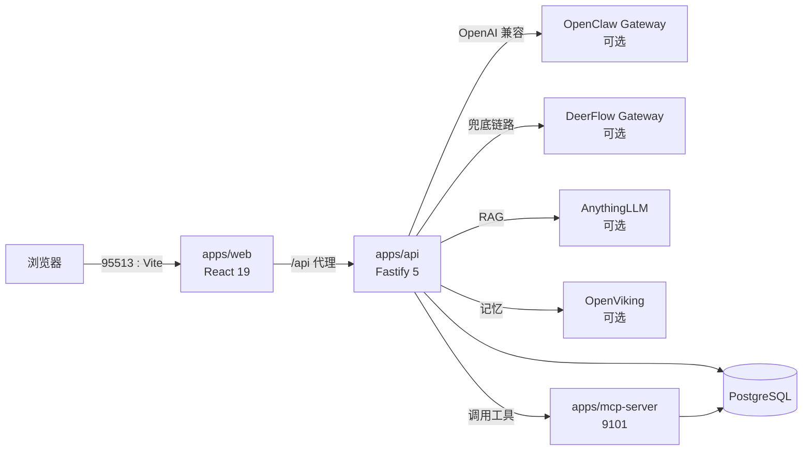

# leyova

AI 直播运营管理系统 —— 面向直播电商团队的经营数据、复盘、AI 助手与运营自动化平台。

包含三个可独立部署的子系统：

| 子系统 | 技术栈 | 默认端口 |
|---|---|---|
| `apps/api` | Node.js + Fastify 5 + PostgreSQL + Zod | 8788 |
| `apps/web` | React 19 + TypeScript + Vite + Tailwind CSS v4 | 95513 |
| `apps/mcp-server` | Node.js + MCP 工具服务（21 个工具） | 9101 |

## 特性

- **经营驾驶舱**：直播间/主播/商品多维数据看板，实时监控与异常预警
- **直播复盘**：场次复盘报告、指标矩阵、建议与改进任务闭环
- **数据导入**：CSV / XLSX 导入，模板自动识别，批次与错误明细
- **AI 运营助手**：会话式问答、日报生成、巡检记录（可对接 OpenClaw / DeerFlow / AnythingLLM / OpenViking）
- **MCP 工具服务**：21 个业务工具，按风险分级 + 审批 + 审计日志
- **RBAC 权限**：角色 → 模块 → 权限三层控制，菜单与接口双向校验
- **双主题 UI**：暗/亮主题设计系统（基于 Orbit Admin Dashboard 模板）

## 技术栈

- Node.js ≥ 22，pnpm 11（workspace monorepo）
- 后端：Fastify 5、`pg`、zod、pino、node-cron、bcryptjs
- 前端：React 19、React Router 7、TanStack Query 5、Tailwind CSS 4、Recharts、Framer Motion
- 数据库：PostgreSQL 14+

## 架构



目录：

```
leyova/
├─ apps/
│  ├─ api/           Fastify 后端（routes / lib / ai / qm / cron / cli / prisma）
│  ├─ web/           React 前端（39 条路由、11 个业务域、components/ui 组件库）
│  └─ mcp-server/    MCP 工具服务（21 个工具 + 风险分级/审批/审计）
├─ docs/
│  ├─ architecture.md   系统架构说明
│  └─ design.md         前端设计说明
├─ ecosystem.config.cjs PM2 进程配置
├─ pnpm-workspace.yaml
└─ LICENSE / NOTICE
```

## 快速开始

### 1. 准备环境

- Node.js ≥ 22（见 `.nvmrc`）
- pnpm ≥ 10：`npm i -g pnpm`
- PostgreSQL ≥ 14，并准备一个空库

### 2. 安装依赖

```bash
pnpm install
```

### 3. 配置环境变量

```bash
cp apps/api/.env.example apps/api/.env
cp apps/mcp-server/.env.example apps/mcp-server/.env
cp apps/web/.env.example apps/web/.env
```

编辑 `apps/api/.env`，至少填写：

```dotenv
DB_HOST=localhost
DB_PORT=5432
DB_NAME=leyova
DB_USER=postgres
DB_PASSWORD=your-password
SESSION_SECRET=<64 位随机串>
```

`apps/mcp-server/.env` 至少填写 `DATABASE_URL`。

> AI 相关变量全部可选；`AI_ENABLED=false` 时 AI 对话走规则兜底逻辑。

### 4. 初始化数据库

仓库不包含任何 SQL 数据文件（原始库中含真实经营数据）。请用自己的迁移/初始化脚本建表，
或先启动服务后通过系统管理页初始化基础数据。

### 5. 启动

```bash
# 同时启动 api + web + mcp-server
pnpm dev
```

或分开启动：

```bash
pnpm dev:api   # http://localhost:8788
pnpm dev:web   # http://localhost:95513
pnpm dev:mcp   # http://localhost:9101
```

打开 `http://localhost:95513` 即可。

### 6. 生产构建

```bash
pnpm build
pm2 start ecosystem.config.cjs
```

## 环境变量

完整清单见 `apps/api/.env.example`，关键项：

| 变量 | 默认值 | 说明 |
|---|---|---|
| `NODE_ENV` | development | 运行环境；production 时强制校验 `SESSION_SECRET` / `LEYOVA_MCP_TOKEN` |
| `PORT` | 8788 | 后端监听端口 |
| `WEB_ORIGIN` | http://localhost:95513 | CORS 允许源 |
| `SESSION_SECRET` | dev 默认值 | 会话密钥，生产必须设置 |
| `DB_HOST` / `DB_PORT` / `DB_NAME` / `DB_USER` / `DB_PASSWORD` | localhost / 5432 / leyova / postgres / 空 | 数据库连接 |
| `DATABASE_URL` | — | 连接串，存在时优先 |
| `DEFAULT_USER_PASSWORD` | 空 | 创建账号未填密码时的默认密码；留空则必须显式指定 |
| `AI_ENABLED` | false | AI 总开关 |
| `OPENCLAW_HOME` | 空 | OpenClaw 安装目录；未配置则 AI 配置写入/重启能力关闭 |
| `LEYOVA_MCP_TOKEN` | dev 默认值 | 调用 MCP Server 的 Bearer token，生产必须设置 |
| `MCP_PORT` | 9101 | MCP Server 端口 |
| `LOG_LEVEL` / `LOG_ROOT` | info / 空 | 日志级别与目录（留空为 `./logs`） |

前端变量（`apps/web/.env`，可选）：

| 变量 | 默认值 | 说明 |
|---|---|---|
| `VITE_PORT` | 95513 | 开发服务器端口 |
| `VITE_API_TARGET` | http://localhost:8788 | `/api` 代理目标 |
| `VITE_ALLOWED_HOSTS` | 空（允许全部） | 允许访问的 Host，逗号分隔 |

### 可选组件

| 组件 | 作用 | 相关变量 |
|---|---|---|
| OpenClaw | 主 AI Agent 运行时（OpenAI 兼容网关） | `OPENCLAW_*` |
| DeerFlow | 备用 Agent 链路（LangGraph 兼容网关） | `DEERFLOW_*` |
| AnythingLLM | 知识库 / RAG | `ANYTHINGLLM_*` |
| OpenViking | 上下文 / 记忆 | `OPENVIKING_*` |

不配置这些组件不影响系统主体功能。

## 与既有系统并行运行

各子系统端口集中在 `apps/api/.env`、`apps/mcp-server/.env`、`apps/web/.env` 与
`ecosystem.config.cjs`，如需与另一套实例并存，改这几处即可（默认已是 8788 / 95513 / 9101）。

自检：

```bash
curl -s -o /dev/null -w "%{http_code}\n" http://localhost:8788/health
curl -s -o /dev/null -w "%{http_code}\n" http://localhost:9101/health
```

## Known Issues

以下为当前版本已知问题，本次开源提取未做功能修复：

1. `GET /api/v1/sessions/:id` 未强制做归属鉴权，建议在网关或代码层补充校验。
2. 会话 Cookie 在非 HTTPS 环境使用 `secure: false`，生产部署请置于 HTTPS 反代之后并开启。
3. `apps/api/src/qm/` 模块尚未接入主流程。
4. 前端部分组件与 `src/data/` 中的示例数据未被引用。
5. `apps/api/prisma/schema.prisma` 与实际数据库结构不完全一致，仅作参考。
6. 开发默认值（`SESSION_SECRET`、`LEYOVA_MCP_TOKEN`）仅供本地调试，生产启动会强制要求覆盖。

## 贡献

1. Fork 并创建分支
2. 提交前运行 `pnpm build` 与 `pnpm test`
3. 提交 PR 描述变更动机与验证方式

## License

本项目以 [Apache License 2.0](LICENSE) 发布，Copyright 2026 leyova。

上游归属与第三方声明见 [NOTICE](NOTICE)（Web 前端基于 ThemeWagon 的 Orbit Admin Dashboard 模板，MIT 许可）。
