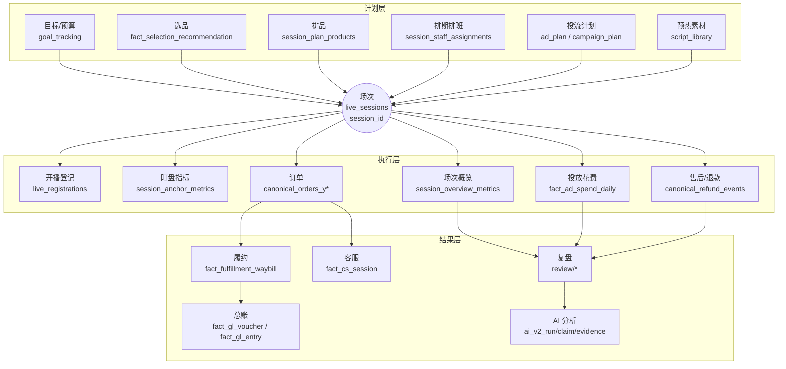
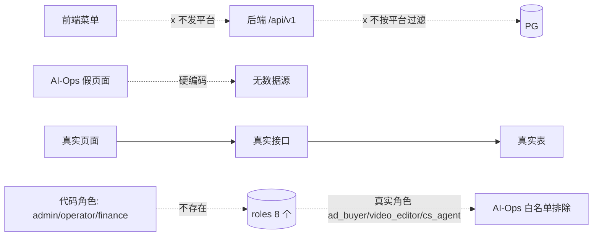

# 05 · 功能关系图谱

> 说明：本图描述「业务动作 → 模块 → 数据表 → 接口 → 页面」的真实依赖，不按菜单画。
> 数据层事实见 `_evidence/02-db-rowcounts.md`，接口事实见 `_evidence/03-api-authz-matrix.md`。

## 一、总图：以「场次」为枢纽

**结论**：数据模型是健康的——所有业务动作都能挂到 `session_id`。问题在 UI 层被两套导航切断（见第三节）。

## 二、模块 × 数据表 × 接口 对应表

| 业务模块 | 主表 | 关键接口 | 页面 | 状态 |
|---|---|---|---|---|
| 今日作战 | `overview_daily_stats`、`alert_events`、`goal_tracking` | `/overview/*`、`/system/alerts`、`/system/tasks` | `AiOpsCockpit`、`PlatformAwareHomePage` | 数据空/假 |
| 场次 | `live_sessions`、`live_registrations` | `/overview/sessions`、`/sessions/:id`、`/sessions/:id/pnl` | 场次列表、`AiOpsReview` | 可用（无平台过滤） |
| 排品 | `session_plan_products`（446，417 损坏） | `/sessions/:id/slots` | `AiOpsPlanning`、`SessionProductsPage` | 数据损坏 |
| 排班 | `session_staff_assignments`、`staff_day_status` | `/hrbp/attendance`、`/schedule/*` | `ScheduleManagement`、`HrbpWorkspace` | 可用 |
| 主播 | `anchors`、`session_anchor_metrics` | `/anchors`、`/review/anchors` | `AnchorList`、`AnchorProfile`、`AnchorPerformance` | 真实页可用；`AiOpsPeople` 造假 |
| 投流 | `fact_ad_spend_daily`、`ad_plan`、`campaign_plan` | `/net-roi/overview` | `NetRoiPage`、`AiOpsCampaigns` | 花费真/活动假 |
| 订单 | `canonical_orders_y2026*` | `/orders/*` | 订单相关 | 演示数据 |
| 履约 | `fact_fulfillment_waybill` | `/fulfillment/*` | `FulfillmentSla` | 演示数据 |
| 售后 | `canonical_refund_events`、`fact_cs_session` | `/after-sales/*`、`/customer-service/*` | `AfterSales`、`CustomerService`、`RefundAnalysis` | 演示数据 |
| 财务 | `fact_gl_voucher`（60，仅 11-16）、`fact_gl_entry`（114） | `/finance/*` | `AiOpsFinancePnl`、`AiOpsFinanceSettle` | 假成本/假签名 |
| 内容 | `script_library`（96）、`content_*`（多张 0 行） | `/scripts/templates`（403）、`/content/*` | 话术库、`VideoData`、`AiOpsClips` | 权限/空 |
| 达人 | `dim_kol`（0）、`fact_kol_cooperation`（0） | `/kol/*` | `KolCooperation` | 空 |
| 数据治理 | `raw_*`/`clean_*`/`canonical_*` 月分区 | `/data/*` | `DataManagement` 等 5 页 | 结构完整、几乎无数据 |
| AI | `ai_v2_*`（5 万+）、`ai_eval_run`（3420） | `/ai/*`、`/calibration` | `ChatPage`、`AnalysisWorkbench`、`AiOpsMetrics` | 最强项 |
| 系统 | `users`、`roles`、`system_modules`、`audit_logs` | `/system/*`、`/auth/*` | 用户/角色/模块/审计 | 角色名不一致 |

## 三、断点图谱（哪里断了）

具体断点：

1. **平台维度**：`菜单 platforms` → ✅；`请求头` → ❌；`SQL where` → ❌。
2. **角色维度**：`Layout/RequireAiOpsAccess 白名单`（含 `admin`/`operator`/`finance`）→ DB `roles` 无这三个 → 白名单有一半是空转；`ad_buyer`/`video_editor`/`cs_agent` 被排除。
3. **数据维度**：`ai-ops-data.ts` 在真实分支内仍用下标公式 → 数据真、指标假。
4. **反馈维度**：`catch {}` + `return true` → 用户永远看到「成功」。

## 四、关联强度（改一个会牵动谁）

| 改动点 | 直接影响 | 间接受影响 |
|---|---|---|
| `route-manifest.ts` | 经典侧栏、classic-routes、Topbar 面包屑（副本需同步） | 搜索、权限提示 |
| `system_modules` / `roles` | `/auth/me` 的 `access.modules` | 全部 `RequireAccess` 页面、侧栏 `canSee` |
| `platform_capability_matrix` | `/platforms` capabilities | 侧栏 `isModuleSupported`、`platformRoute` 提示 |
| `ai-ops-data.ts` | AI-Ops 12 个页面 | 驾驶舱、审批、任务、绩效、财务 |
| `session_plan_products` 修复 | 排品、货盘、复盘商品分析 | `/sessions/:id/slots`、`/review/products` |
| `roles` 增删 | 登录后首页、AI-Ops 准入 | 财务专区、HRBP 专区 |

## 五、结论

- **模型层不需要大改**：`session_id` 枢纽是对的。
- **UI 层需要「二合一」**：把经典与 AI-Ops 两条导航合并为一条以场次为主轴的导航。
- **权限层需要「对齐」**：先统一角色字典，再谈模块热插拔。
- **平台层需要「下沉」**：平台差异必须落到 SQL 与指标口径，而不是菜单过滤。
