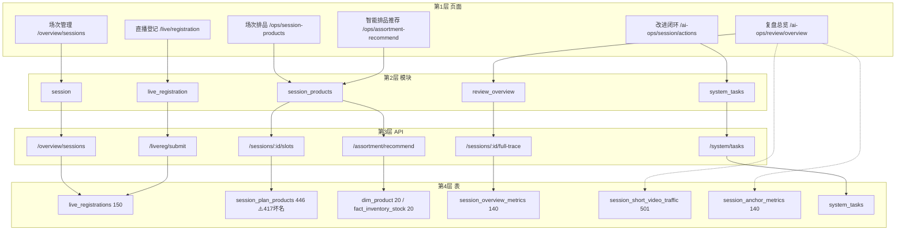
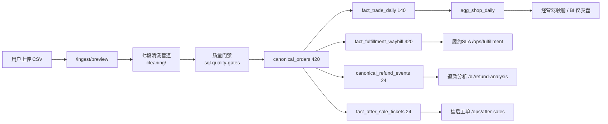
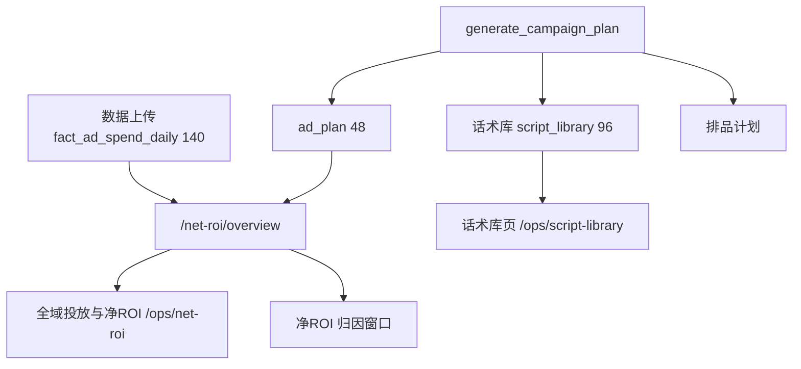
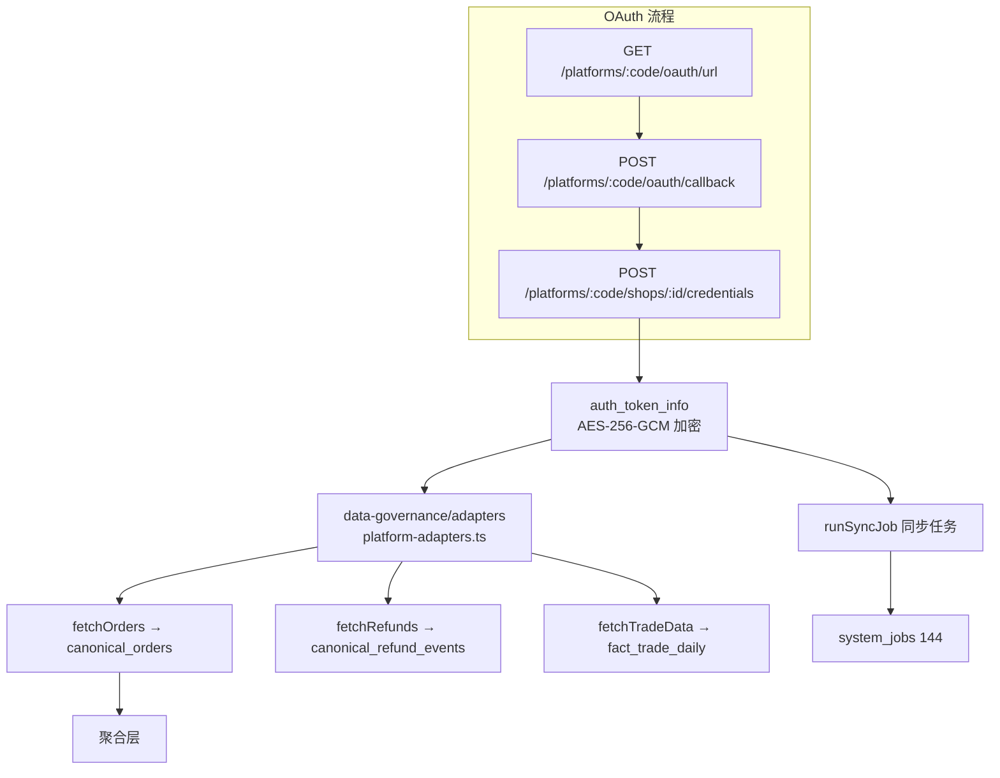
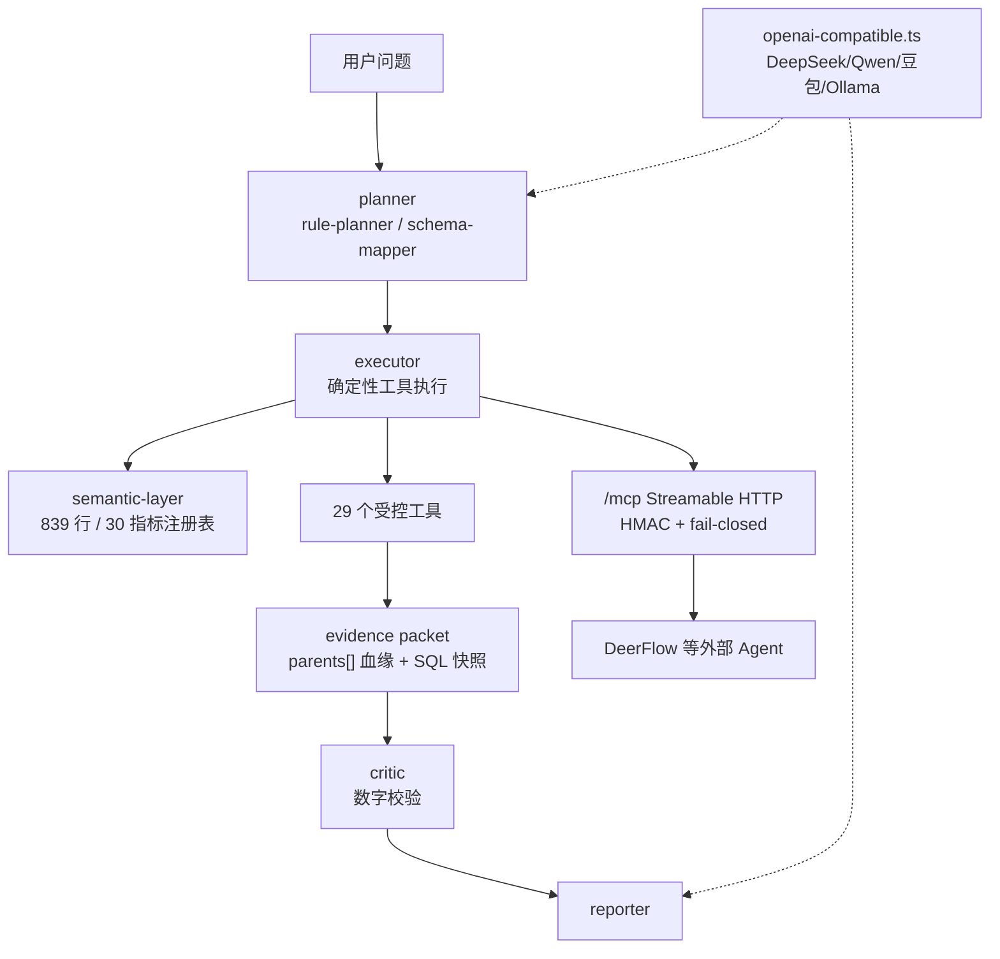
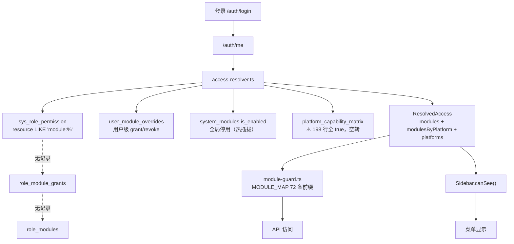
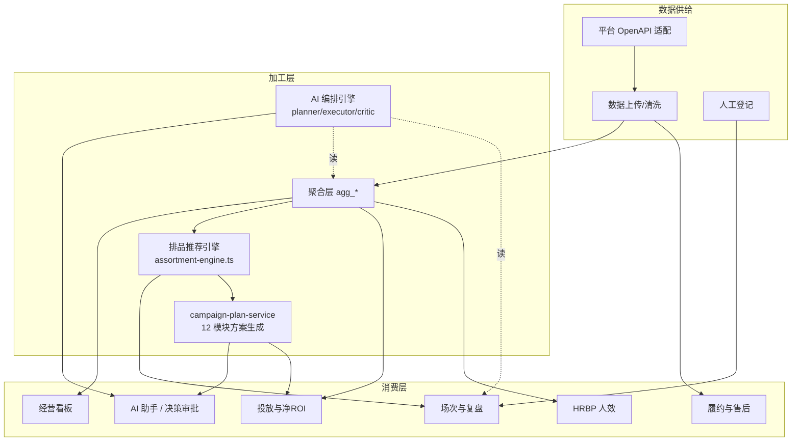

# 维度 5：功能关系图谱

> 五层结构：**页面 → 模块 → API 端点 → 数据表 → 角色**
> 覆盖 90 个经典导航项 + 28 个 AI-Ops 导航项 + 41 个模块 + 8 个角色。

---

## 一、五层总览

```
┌─────────────────────────────────────────────────────────────┐
│ 第 1 层  页面（90 经典 + 28 AI-Ops = 118 个导航入口）          │
│          route-manifest.ts / ai-ops-navigation.ts            │
├─────────────────────────────────────────────────────────────┤
│ 第 2 层  模块（41 个，28 个受核心保护）                        │
│          system_modules 表 + module-guard.ts MODULE_MAP       │
├─────────────────────────────────────────────────────────────┤
│ 第 3 层  API 端点（439 个运行时路由）                          │
│          apps/api/src/routes/*.ts (76 文件)                   │
├─────────────────────────────────────────────────────────────┤
│ 第 4 层  数据表（252 张，含 4 张 _deprecated_*）               │
│          fact_* / dim_* / agg_* / canonical_* / session_*     │
├─────────────────────────────────────────────────────────────┤
│ 第 5 层  角色（8 个）× 用户（40，含 25 个测试污染账号）         │
│          sys_role_permission → role_module_grants → role_modules │
└─────────────────────────────────────────────────────────────┘
```

---

## 二、页面 → 模块 → API → 表 主链路

### 2.1 场次闭环（系统最完整的一条链）



**这条链是系统唯一做到数据闭环的部分**，也是排品四因子引擎（`assortment-engine.ts`）的所在地。

### 2.2 数据接入链（全站最实）



**断点**：`canonical_orders` → 运单/退款/工单的派生只存在于**演示数据生成器**（`database/demo/generate.mjs` 6.5b 段），**生产链路没有这个派生逻辑**。真实订单进来后，下游表不会自动生成。

### 2.3 投放与净 ROI 链



**断点**：`/api/v1/scripts/templates` 未进 `MODULE_MAP` → 非管理角色 403。

### 2.4 平台适配链（真实可用但覆盖面窄）



**能力边界**：`base.ts:104-110` 的 `fetchTrafficData` **直接返回空数组**，注释写明「各开放平台流量报表接口需另行申请数据大盘权限，当前未启用前返回空集（不伪造流量数据）」。这是**正确的工程诚实**，但也意味着流量数据只能靠手工上传。

### 2.5 AI 编排链（真身）



**关键设计**：`executor.ts` 的核心原则是「纯代码执行，绝不让 LLM 接触或直接运行 SQL」，每个数值自动生成 `EvidenceItem`（带血缘和 SQL 快照）。**这是全系统最值钱的工程资产。**

### 2.6 权限解析链（问题集中区）



**三个断点**：
1. `platform_capability_matrix` 全 true → `modulesByPlatform` 六平台相同
2. `MODULE_MAP` 缺 7 个路径 → 非管理角色 403
3. 前端 `Layout.tsx:77-79` / `RequireAiOpsAccess.tsx` 硬编码角色名与 DB 不符

---

## 三、模块 → 数据表 映射（41 模块核心 28 个）

| 模块 | 主要数据表 | 行数（2026-11-19） |
|---|---|---:|
| `session` | `live_registrations` | 150 |
| `session_products` | `session_plan_products` | 446 ⚠️ |
| `overview` | `fact_trade_daily` / `agg_shop_daily` | 140 |
| `bi` | `fact_*` / `agg_*` / `canonical_*` | — |
| `anchor` | `anchors` / `anchor_profiles` / `anchor_capabilities` / `anchor_training_plans` | 12/12/12/4 |
| `review*`（5 个） | `session_overview_metrics` / `session_short_video_traffic` / `session_anchor_metrics` / `session_channel_metrics` | 140/501/140/— |
| `personal_achievement` | `personal_achievement` | — |
| `live_registration` / `live_data` | `live_registrations` | 150 |
| `product_center` | `dim_product` / `fact_inventory_stock` / `dim_product_channel_listing` | 20/20/80 |
| `net_roi` | `fact_ad_spend_daily` / `ad_plan` / `ad_plan_receipts` | 140/48 |
| `search_seo` | `fact_search_keyword_daily` | **0** ❌ |
| `fulfillment` | `fact_fulfillment_waybill` / `fact_inventory_reservation` | 420 |
| `after_sales` | `fact_after_sale_tickets` | 24 |
| `customer_service` | `fact_cs_session` | 480 |
| `content` | `fact_content_daily` / `content_schedules` | **0/0** ❌ |
| `content_schedule` | 同上 | **0** ❌ |
| `kol` | `fact_kol_cooperation` | **0** ❌ |
| `members` | `platform_members_summary` | **0** ❌ |
| `ops` | `goal_tracking` / `issue_library` / `script_library` | 7/**0**/96 |
| `system_tasks` | `system_tasks` | — |
| `system_alerts` | `alert_events` | 12 |
| `system_promotions` | `promotions` | **0** ❌ |
| `system_competitors` | `competitor_brands` | **0** ❌ |
| `system_multiroom` | `multi_room_status` | **0** ❌ |
| `compliance` | `compliance_events` | **0** ❌（且采集器是 MOCK） |
| `data` | `data_uploads` / 清洗管道 | — |
| `system_ai` | `ai_config` / `ai_tool_logs` | **0**（未配置） |
| `ai` | AI 编排引擎 | — |

---

## 四、角色 → 模块 权限矩阵（DB 实测）

`/auth/me` 返回的 `access.modules`（hr_li 实测，18 个模块）：
```
ai, anchor, bi, cost_visibility, live_data, live_registration, net_roi, ops,
overview, personal_achievement, review, review_anchors, review_channels,
review_closed_loop, review_funnel, review_overview, session, system_personnel_ops
```

| 角色 | 账号数 | 代表账号 | 模块数 | 关键能力 |
|---|---:|---|---:|---|
| `super_admin` | 1 | `admin` | 41 | 全部 |
| `ops_director` | 2 | `manager_liu`, `director_zhou` | 34 | 经营全域 + 成本 |
| `ops_staff` | 2 | `operator_wang`, `staff_lin` | 24 | 运营执行（**话术库/选品 403**） |
| `hrbp` | 1 | `hr_li` | 18 | 人效 + 复盘 + 排班 |
| `ad_buyer` | 6（含 5 个测试账号） | `buyer_xu`, `finance_chen` | 14 | 投流 + 关键词 + Net-ROI |
| `controller` | 5 | `ctrl_douyin/taobao/xhs/wechat/wu` | 6 | 人工登记 + 只读场次/排品/排班 |
| `video_editor` | 1 | `video_lin` | 14 | 内容 + 排品 + 复盘 |
| `cs_agent` | 1 | `cs_qian` | 12 | 售后 + 客服 + 履约 |

**角色相关的三个断点**：
1. `finance_chen` 的角色是 `ad_buyer`，但 UI 把他当财务（`canAccessFinance` 检查 `finance` 角色）→ **进不了财务页**
2. `controller` 在 `FINANCE_ALLOWED_ROLES` 里 → **中控能进财务页**
3. `ad_buyer` / `video_editor` / `cs_agent` 不在 `AI_OPS_ALLOWED_ROLES` → **进不了 AI-Ops**

---

## 五、跨模块依赖关系



---

## 六、断点汇总（按链路）

| 链路 | 断点 | 性质 |
|---|---|---|
| 场次闭环 | `session_plan_products` 417 行坏商品名 | 数据 bug |
| 场次闭环 | `room_health` / `multi_room_status` 0 行 | 缺数据 |
| 数据接入 | `canonical_orders` → 下游派生只在演示生成器里，生产链路没有 | 实现缺失 |
| 数据接入 | `fetchTrafficData` 恒返空（未申请数据大盘权限） | 外部依赖 |
| 投放 | `/scripts/templates` 未映射 → 非管理角色 403 | 配置缺失 |
| 投放 | `fact_search_keyword_daily` 0 行 | 缺数据 |
| 履约 | 演示数据 ≠ 真实数据；`fact_settlement_cycles` 0 行 | 数据缺口 |
| 人效 | 排班×场次已打通 ✅ | 无 |
| AI | `ai_config` 0 行 → 知识库未配置；LLM `AI_ENABLED` 默认 false | 未配置 |
| AI | 合规采集器 MOCK | 实现缺失 |
| 权限 | `platform_capability_matrix` 空转 | 配置失效 |
| 权限 | 前端角色名与 DB 不符 | 配置漂移 |
| 权限 | AI-Ops 无 module 维度 | 设计缺失 |

---

## 七、一页速查：哪个模块真的有数据

| 状态 | 模块 |
|---|---|
| ✅ 数据充分 | `session` `session_products` `overview` `bi` `anchor` `review*` `data` `live_registration` `live_data` `product_center` `net_roi` `ops`(部分) `fulfillment` `after_sales` `customer_service` `system_*` |
| ⚠️ 数据稀薄 | `system_alerts`(12) `ops`(`goal_tracking` 7 / `issue_library` 0) |
| ❌ 0 数据 | `search_seo` `system_promotions` `system_competitors` `system_multiroom` `compliance` `content` `content_schedule` `kol` `members` |
| ⚠️ 假数据 | AI-Ops 的 Cases/Clips/Campaigns/FinanceSettle/AssortmentStructure；`compliance` 采集器 |
| 🔧 未配置 | `system_ai`(`ai_config` 0) `ai`(LLM 未启用) |
