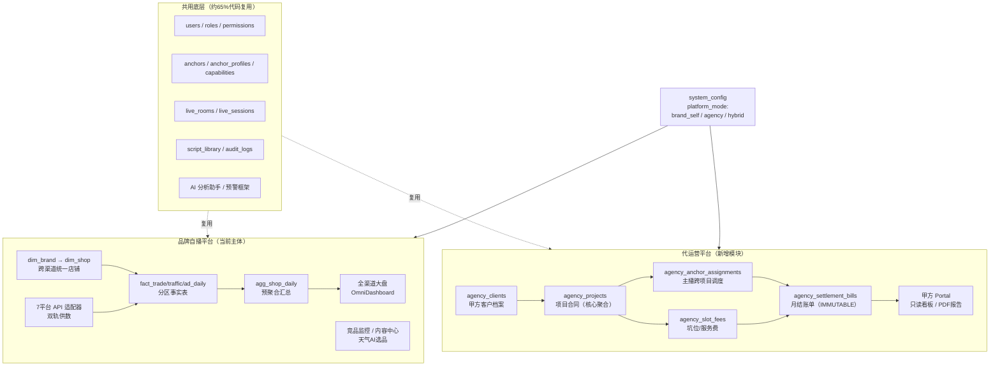
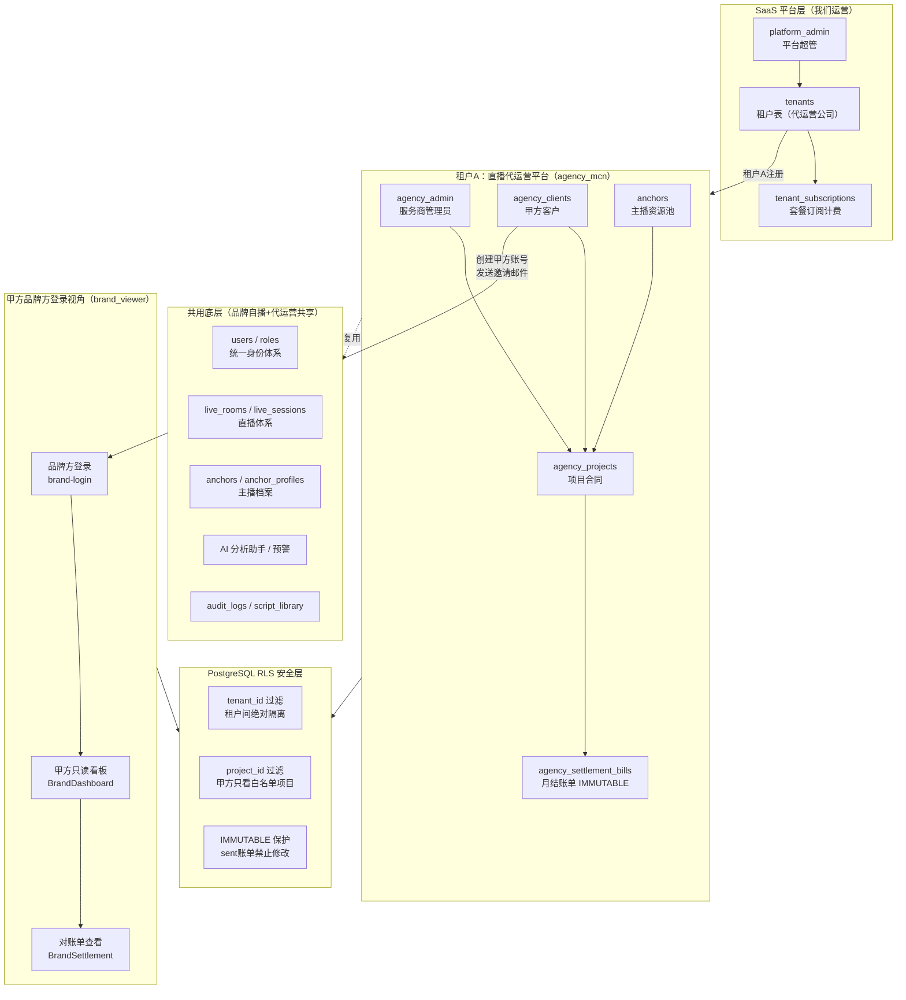

# 全平台电商升级与 AI 分析助手深度重构 · 实施方案与开发计划 (最终审计修订版)

> **基准代码库**：`/home/leyova`（React 19 + Fastify 5 + PostgreSQL 18，端口 55432，59 张业务表）  
> **重大架构决议**：
> 1. **外部 AI 解耦与纯接口化保留**：
>    - 彻底下线与清理 OpenClaw、DeerFlow、AnythingLLM 运行时与冗余依赖；
>    - **OpenViking 仅作为纯外部 API 客户端接口保留**（`openviking-client.ts`），**绝不将 OpenViking 服务或运行环境打包安装到系统内部**。支持通过环境变量/后台配置外部服务地址，未配置或离线时优雅降级，完全不阻塞 AI 分析助手的主链路。
>    - 企业知识库**不自研底层引擎**，采用成熟开源方案（推荐 **RAGFlow** / **MaxKB**）的标准 REST API 进行松耦合集成。
> 2. **平台启停总控与细粒度二维权限矩阵**：管理员拥有全站 7 大平台（抖音、快手、淘宝、天猫、京东、拼多多、小红书）的**全局启用/禁用总开关**；结合角色与人员，构建 **「平台 × 功能模块」二维权限控制网格**，未授权或未开启的平台在整站彻底隐形。
> 3. **根实体桥接设计**：以 `dim_shop` 为全渠道统一顶层实体，通过 `live_rooms.shop_id` 桥接现有直播体系，老业务表 100% 零破坏兼容。
> 4. **双轨供数与可自定义清洗**：官方 OpenAPI 与手动上传双轨汇入统一事实表，集成可视化管道清洗引擎。

---

## 一、系统现状审计与关键架构解耦 (System Audit & Decoupling)

基于对数据库 59 张表、后端 85+ API 端点、前端 45 个页面的深度代码审计，确立以下重构解耦原则：

```mermaid
graph TD
    subgraph 外部服务松耦合集成 (纯客户端接口，不内嵌服务)
        OC[OpenClaw: 彻底废弃移除] -.->|移除代码与配置| Clean[自研轻量 Agentic 编排器]
        DF[DeerFlow: 彻底废弃移除] -.->|移除网关与 Token| Clean
        AL[AnythingLLM: 废弃移除] -.->|替换为| OpenKB[外部开源企业知识库 RAGFlow/MaxKB (REST API)]
        OV[外部 OpenViking 实例] ===>|纯 HTTP 客户端接口 (未部署时优雅跳过)| Clean
    end

    subgraph 实体桥接模型
        P[dim_platform 平台字典] --> S[dim_shop 跨渠道统一店铺/主体]
        S -->|1:N 桥接现有直播体系| LR[live_rooms 现有直播间]
        S -->|1:N 货架直接挂载| FT[fact_trade_daily 交易事实]
        S -->|1:N 统一商品体系| DI[products / dim_item 商品]
        LR --> LS[live_sessions 现有直播场次保持不变]
    end

    subgraph 二维权限中枢
        Admin[系统最高管理员] -->|全局启停开关| PlatformConfig[system_platform_configs]
        PlatformConfig --> Matrix[二维权限矩阵: 平台范围 x 功能模块]
        Matrix --> UserA[拼多多运营: 仅拼多多货架]
        Matrix --> UserB[抖音主播: 仅抖音直播间]
        Matrix --> UserC[全渠道总监: 全部已开启平台]
    end
```

---

## 二、平台启停与二维权限控制矩阵 (Platform Governance & RBAC Matrix)

### 2.1 管理员全局平台总控开关
在系统配置中心新增「平台与渠道管理」，管理员可对 6 大生态 7 个平台进行启停控制：
- 抖音 (`douyin`)、快手 (`kuaishou`)、淘宝 (`taobao`)、天猫 (`tmall`)、京东 (`jd`)、拼多多 (`pdd`)、小红书 (`xiaohongshu`)。
- **全局阻断机制**：
  - 若管理员关闭了“拼多多”，则全站导航栏、数据大盘选择器、AI 问答指标范围、数据上传模板选择器中，拼多多相关内容**全链路隐藏**。
  - 后端中间件校验：请求带未开启的 `platform_code` 时，直接返回 `403 Platform Disabled`。

### 2.2 人员与角色细粒度二维权限矩阵 (`Role/User × Platform × Module`)
在原有 `system_modules` / `role_modules` 基础上，升级为二维权限模型：

```sql
-- 1. 系统平台全局配置表（最高管理员维护）
CREATE TABLE public.system_platform_configs (
    platform_code varchar(32) PRIMARY KEY,
    platform_name varchar(50) NOT NULL,
    category varchar(20) NOT NULL, -- 'live' | 'shelf' | 'content'
    is_enabled boolean DEFAULT true NOT NULL,
    sort_order integer DEFAULT 0,
    api_config jsonb DEFAULT '{}'::jsonb,
    created_at timestamptz DEFAULT now(),
    updated_at timestamptz DEFAULT now()
);

-- 2. 角色-平台授权表
CREATE TABLE public.role_platform_permissions (
    id serial PRIMARY KEY,
    role_id integer NOT NULL REFERENCES public.roles(id) ON DELETE CASCADE,
    platform_code varchar(32) NOT NULL REFERENCES public.system_platform_configs(platform_code) ON DELETE CASCADE,
    allowed_modules text[] DEFAULT '{}'::text[], -- 允许访问该平台的哪些模块代码，为空表示全部
    created_at timestamptz DEFAULT now(),
    UNIQUE(role_id, platform_code)
);

-- 3. 用户特化平台授权表（针对特定员工加减权限）
CREATE TABLE public.user_platform_permissions (
    id serial PRIMARY KEY,
    user_id integer NOT NULL REFERENCES public.users(id) ON DELETE CASCADE,
    platform_code varchar(32) NOT NULL REFERENCES public.system_platform_configs(platform_code) ON DELETE CASCADE,
    shop_scope bigint[] DEFAULT '{}'::bigint[], -- 限定特定店铺 ID 列表，空表示该平台全部店铺
    created_at timestamptz DEFAULT now(),
    UNIQUE(user_id, platform_code)
);
```

#### 前端与后端权限裁决逻辑
1. **有效平台交集计算**：
   $$\text{UserAccessiblePlatforms} = \text{SystemEnabledPlatforms} \cap \text{RolePlatforms} \cap \text{UserPlatforms}$$
2. **菜单动态裁决**：
   - `navigation.ts` 改造为纯动态计算函数：过滤掉不在用户 `UserAccessiblePlatforms` 范围内的平台专属板块；
   - 顶部选择器 `PlatformShopSelector` 仅展示当前用户有权且系统已开启的平台与店铺。

---

## 三、外部 AI 瘦身与开源企业知识库集成

### 3.1 外部 AI 架构精简与纯客户端接口设计
- **彻底下线 OpenClaw**：原网关中用于调用 OpenClaw 的转发代码、配置同步路由全部剥离，避免外部未受控的 Agent 产生不可预知的 SQL 与循环调用。
- **彻底下线 DeerFlow**：废弃 DeerFlow 内部 Token 与网关兜底，AI 助手全部走自研受控编排。
- **OpenViking 仅保留外部纯客户端接口 (External Plugin Interface Only)**：
  - **明确不安装**：系统本身**不部署、不打包、不依赖**本地 OpenViking 进程或运行时；
  - **仅保留客户端代码**：保留 `apps/api/src/lib/openviking-client.ts` 作为轻量 HTTP 适配器；
  - **按需接入与优雅降级**：通过环境变量 `OPENVIKING_API_BASE` 与 `OPENVIKING_API_KEY` 配置外部已部署的实例地址；若未配置或服务不可达，系统自动静默跳过长效记忆检索，直接依赖当前对话上下文，**核心问数与分析功能 100% 正常运行**。

### 3.2 企业知识库开源替代方案：集成 RAGFlow / MaxKB
**原则：不从零自建文档解析、切片与检索管道，直接通过 REST API 接入业界最顶级的开源企业级 RAG 引擎。**

#### 选型评估推荐：
1. **首选方案：RAGFlow (开源深度文档解析与混合检索系统)**
   - **优势**：具备业界最强的深度文档解析引擎（DeepDoc），对电商领域的复杂财务报表 Excel、多栏大促 PDF、表格和图表识别精度极高；原生支持密集与稀疏混合检索；提供开箱即用的标准 REST API。
2. **备选方案：MaxKB / FastGPT**
   - **优势**：极简部署、API 规范极度清晰，开箱支持按知识库 ID、分权限调用问答与上下文检索。

#### 集成对接设计 (`apps/api/src/lib/kb-client.ts`)
```typescript
export interface KnowledgeBaseClient {
  /** 检索与当前业务问题相关的知识切片（包含平台运营规则、爆款卖点、大促复盘经验） */
  searchContext(query: string, options: {
    datasetIds: string[]
    topK?: number
    similarityThreshold?: number
  }): Promise<KnowledgeChunk[]>
  
  /** 将 AI 复盘报告或战报一键推送到企业知识库沉淀 */
  uploadDocument(collection: string, doc: {
    title: string
    content: string
    metadata: Record<string, any>
  }): Promise<{ docId: string }>
}
```
- **业务打通**：AI 分析助手的原子工具 `search_knowledge` 直接代理调用该开源知识库 API；
- **免维护底座**：知识库的向量计算、文件上传解析全部由独立的开源知识库容器负责，主数据库无需承载沉重的文档解析与非结构化重载。

---

## 四、双轨数据接入与自定义数据清洗引擎

### 4.1 7 大平台官方 OpenAPI 连接器规范
系统在 `apps/api/src/platform/adapters/` 目录下预留各平台标准适配器：
1. `douyin.ts`（抖店 OpenAPI / 千川投放 API）
2. `kuaishou.ts`（快手小店 OpenAPI / 磁力金牛 API）
3. `taobao.ts`（阿里开放平台 TOP API / 万相台直通车）
4. `tmall.ts`（天猫品牌店铺专用扩展，复用淘系底层）
5. `jd.ts`（京东 JOS 开放平台 / POP+自营采销 API）
6. `pdd.ts`（拼多多开放平台 POP API / 多多搜索推广）
7. `xiaohongshu.ts`（小红书方舟开放平台 / 蒲公英合作数据 API）

每个适配器实现统一接口 `PlatformAdapter`：
- `exchangeToken` / `refreshToken`：统一 OAuth 凭证换取与刷新。
- `fetchTradeData` / `fetchTrafficData` / `fetchAdData`：拉取对应标准事实模型。
- `syncWatermark`：增量同步游标控制，防止重复拉取。

### 4.2 手动上传自定义数据清洗引擎 (Pipeline Rule Engine)
针对未开通 API 权限的店铺，通过手动上传提供 100% 功能体验。

#### 7 大类清洗规则元语：
1. **结构映射**：`rename_column`、`drop_column`、`split_column`、`merge_columns`
2. **类型解析**：`cast_currency`（清除货币符号/千分位）、`cast_percent`（百分比浮点转换）、`cast_duration`（中文时长转换为秒/分）、`cast_datetime`
3. **空值与默认值**：`fill_null`、`drop_if_null`、`default_value`
4. **去重与合并**：`dedup_by_keys`（多列联合去重，保留最新/数值大）
5. **异常截断**：`range_clip`（数值越界截断）、`outlier_iqr`（箱线图异常值探测）
6. **枚举归一与正则**：`map_value`（如“天猫旗舰店”→`tmall`）、`replace_regex`
7. **业务逻辑校验**：`assert_expr`（如 `gmv >= refund_amount`，异常行自动标记）

#### 前端交互向导 (`DataUploadPage.tsx`)：
1. 上传文件（CSV / XLSX）
2. 识别/选择所属平台与店铺
3. 字段智能映射（系统推荐 + 用户微调）
4. 清洗模式选择（可复用预设模板，或可视化增删清洗规则）
5. **预演 Diff 对照**：查看清洗前后数据样本对照、异常丢弃行清单与统计
6. 确认入库并保存自定义清洗模式为模板

---

## 五、AI 分析助手深度重构 (指标语义层 + 四阶受控编排)

重塑 AI 助手为专业的 Agentic BI 经营分析师：

```
┌──────────────────────────────────────────────────────────────┐
│ 用户前端: ChatPage 3.0 工作台 (三栏布局: 会话/分析流/行动面板)  │
├──────────────────────────────────────────────────────────────┤
│ 会话与上下文层: 短期上下文 + 外部 OpenViking 记忆插件 (纯接口) │
├──────────────────────────────────────────────────────────────┤
│ 受控编排器: Planner DAG → Executor → Critic → Reporter      │
├──────────────────────────────────────────────────────────────┤
│ 8 个受控分析工具:                                            │
│ list_metrics / list_dimensions / query_metric /              │
│ compare_periods / drill_down / detect_anomalies /            │
│ forecast_trend / search_knowledge (调用外部开源知识库 API)   │
├──────────────────────────────────────────────────────────────┤
│ 指标语义层: metric_definition + 参数化 SQL 编译器 + 权限硬注入 │
├──────────────────────────────────────────────────────────────┤
│ 底层数据: PostgreSQL 18 分区事实表 + 预聚合表                │
└──────────────────────────────────────────────────────────────┘
```

### 5.1 六大深度分析剧本 (Playbooks)
1. **S1 经营智能问数**：解析指标/维度/时段 → 语义层取数 → 平台对比 → 结构化卡片与趋势图。
2. **S2 波动与同环比归因**：计算波动差额 → 平台贡献度拆解 → 渠道/商品下钻 → 瀑布图与 TOP3 异动因子。
3. **S3 跨平台全渠道对标**：多平台口径对齐（GMV、毛利率、退款率、ROI） → 对比雷达图与渠道资源建议。
4. **S4 异动与故障定位**：定位异动时段 → 排查广告/商品状态 → 检索开源知识库近期大促与违规事件 → 综合归因。
5. **S5 业绩预测与情景推演**：历史趋势时间序列预测 → 目标缺口分析 → 输出保守/中性/冲刺三套资源配置建议。
6. **S6 全渠道复盘战报自动生成**：全周期指标汇总 → 亮点与短板提炼 → 自动生成 Markdown 报告 → **一键创建改进任务**并沉淀至知识库。

### 5.2 数字 100% 溯源质检 (Critic Verification)
Reporter 产出的所有分析结论必须带有数据来源引用标 `[e1]`、`[e2]`，Critic 模块在交付前端前比对原始工具取数快照：
- 若数字偏差超过 0.1%，自动阻断重写；
- 前端点击任意数字直接呼出「数据凭证面板」，展示统计口径、计算公式与底层快照。

---

## 六、数据库高性能调优与分区实施方案 (一步到位)

### 6.1 核心事实表声明式按月分区 (Range Partitioning)
针对 `fact_trade_daily`、`fact_traffic_daily`、`fact_product_daily`，按 `biz_date` 进行原生月度分区：
```sql
CREATE TABLE public.fact_trade_daily (
    id bigserial,
    biz_date date NOT NULL,
    platform_code varchar(32) NOT NULL REFERENCES public.system_platform_configs(platform_code),
    shop_id bigint NOT NULL REFERENCES public.dim_shop(id),
    channel_name varchar(100),
    gmv numeric(14,2) DEFAULT 0,
    paid_order_count integer DEFAULT 0,
    refund_amount numeric(14,2) DEFAULT 0,
    source varchar(20) DEFAULT 'api' NOT NULL, -- 'api' | 'manual'
    extra jsonb DEFAULT '{}'::jsonb,
    created_at timestamptz DEFAULT now(),
    PRIMARY KEY (biz_date, id)
) PARTITION BY RANGE (biz_date);
```
- 分区局部索引：`CREATE INDEX idx_trade_daily_ps ON fact_trade_daily (biz_date, platform_code, shop_id);`
- 自动分区管理：定时任务提前创建未来 3 个月的新分区，过往冷数据直接 Detach 归档。

### 6.2 预聚合层 (Rollup)
建立 `agg_shop_daily`（按店铺+日聚合）与 `agg_platform_monthly`（按平台+月聚合），AI 与 BI 默认直接查预聚合层，千万级数据查询耗时稳定在 20ms 以内。

---

## 七、分阶段落地里程碑与交付计划

| 阶段 | 交付主题 | 核心交付物 | 关键依赖与边界 |
| :--- | :--- | :--- | :--- |
| **P0 地基与权限矩阵** | 平台底座与实体桥接 | 1. 迁移链建立与 `dim_shop` / `system_platform_configs` / `role_platform_permissions`<br>2. `live_rooms` 增加 `shop_id` 桥接现有 59 表<br>3. 平台管理员总控开关与二维权限中间件<br>4. 冻结 `03_patches.sql` | 现有 45 个页面与全部老功能 100% 正常运行，老表建立只读兼容视图 |
| **P1 双轨接入与清洗** | 官方接口与自定义清洗 | 1. 7 大平台官方 API 接口定义与同步任务脚手架<br>2. 管道式数据清洗引擎（7 类规则 + 预演 Diff 对照）<br>3. 数据上传四步向导改造 | 无 API 授权时以手动上传为兜底，支持自定义模式保存复用 |
| **P2 多平台业务板块** | 货架电商与全渠道大盘 | 1. 淘天、拼多多、京东适配器与数据映射<br>2. 全渠道经营大盘 (`OmniDashboardPage`)<br>3. 货架店铺经营看板 (`ShopOverviewPage`)<br>4. 前端动态能力导航 | 未开启平台全局隐藏，用户只能看到被授权平台的数据 |
| **P3 内容中心与开源知识库** | ComfyUI 与知识库集成 | 1. ComfyUI REST/WebSocket 客户端与模板预设<br>2. 视频创作工作台与视频数据接口<br>3. 开源知识库 (RAGFlow/MaxKB) API 客户端对接 | 本地无 ComfyUI 时 Mock 优雅降级；知识库不自研底层 |
| **P4 AI 分析助手重构 (核心)** | 语义层 + 四阶 Agent | 1. 指标语义层 (`metric_definition` + 参数化 DSL)<br>2. Planner → Executor → Critic → Reporter 自研编排器<br>3. OpenViking 记忆插件（纯客户端 API 接口调用，不内嵌服务），下线 OpenClaw/DeerFlow/AnythingLLM<br>4. ChatPage 3.0 三栏工作台 (SSE 流式 + 图表卡片 + 证据溯源) | 严禁大模型自行算数；结论数字 100% 溯源通过 |
| **P5 深度决策与闭环** | 预测/复盘与全站联动 | 1. S5 目标预测与 S6 复盘战报自动生成<br>2. 一键转改进任务与一键沉淀经验至开源知识库<br>3. BI/复盘页面右上角“AI 分析此屏”全局联动 | 形成“分析 → 归因 → 决策 → 任务 → 知识沉淀”完整闭环 |

---

## 八、待拍板确认项 (Action Items)

1. **开源企业知识库选型**：首选推荐 **RAGFlow**（文档与电商复杂财务表格、PDF 解析能力极强，支持 Docker 一键部署），备选 **MaxKB**（UI 轻巧、API 极简）。你倾向于哪一个作为系统集成的开源知识库底座？
2. **P0 启动授权**：若以上架构决议全部确认无误，请指示批准，我们将立即进入 **P0 阶段的数据库迁移与实体桥接代码实现**！

---

## 九、竞品参考分析与功能迭代补充 (Competitor Benchmarking)

> **参考竞品**：直播代运营平台（agency-live.example.com / data.agency-live.com）  
> **竞品定位**：专注直播代运营场景，服务代播服务商，管理多品牌/多项目直播间（典型客户：星辉品牌管理中心，管理 GAP 抖音、Calvin Klein、李宁等多个品牌项目）  
> **与我们的本质区别**：竞品面向代播服务商，我们面向品牌自营；竞品目前仅支持抖音单平台，我们覆盖 7 大平台。

### 9.1 竞品核心功能拆解

| 竞品模块 | 核心功能 | 我们是否有对应 |
|---------|---------|-------------|
| 运营驾驶舱 | 总GMV / 实际利润 / 人力成本 / 趋势图 | ⚠️ 有GMV，缺"实际利润"和"人力成本"指标卡 |
| 业绩排行榜 | 主播GMV排行 / 项目GMV排行 双维度 Top10 | ❌ 有主播分析页，但驾驶舱无榜单组件 |
| 竞品分析 | 对标竞品数据 | ✅ `CompetitorWatchPage.tsx` 已有 |
| 自营分析 | 自营账号专项 vs 代播项目数据区分 | ❌ 无运营模式区分 |
| 天气AI穿搭 | 天气预报 × 库存 × AI = 今日选品推荐 | ❌ 无此功能，属于特色差异化 |
| AI排班建议 | 历史数据驱动的最优主播排班推荐 | ❌ 有考勤页，无智能排班推荐 |
| 成本数据 | 结构化成本录入（人力/广告/货品/平台费） | ❌ 完全缺失 |
| 数据报警 | 阈值自定义 + 通知推送（钉钉/飞书） | ⚠️ 有异常检测页，缺规则配置与Webhook推送 |
| 我的业绩 | 主播个人视角绩效看板（激励自驱） | ❌ 所有页面均为管理者视角 |
| 项目切换器 | 多品牌/多项目顶部快速切换 | ⚠️ 有店铺切换，缺"品牌/项目"层概念 |
| 全局搜索 | 搜索功能页面 / 数据记录 / 历史报告 | ❌ 无全局搜索 |
| 通知中心 | 系统通知 / 预警通知 / AI洞察推送 | ⚠️ 有告警中心，缺结构化通知收件箱 |

### 9.2 核心差距与功能补充计划

#### 🔴 P0 级补充——支撑经营闭环（最紧迫）

**【补充 9-A】实际利润指标卡 + 净利算法引擎**

竞品驾驶舱第二卡直接显示"实际利润"，注明"运用后端净利算法"，这是经营决策最核心的指标。没有成本录入体系，驾驶舱的价值将大打折扣。

新增净利公式：
```
净利 = GMV × (1 - 退款率) - 广告费 - 人力成本 - 货品成本 - 平台佣金
```

**新增数据库表**：
```sql
-- 成本录入主表（结构化录入，支持按店铺/平台/周期分摊）
CREATE TABLE public.cost_entries (
    id bigserial PRIMARY KEY,
    shop_id bigint NOT NULL REFERENCES public.dim_shop(id),
    platform_code varchar(32) REFERENCES public.system_platform_configs(platform_code),
    cost_date date NOT NULL,
    cost_type varchar(32) NOT NULL, -- 'labor'|'ad'|'goods'|'platform_fee'|'other'
    cost_name varchar(100),
    amount numeric(14,2) NOT NULL,
    remark text,
    created_by integer REFERENCES public.users(id),
    created_at timestamptz DEFAULT now()
);
CREATE INDEX idx_cost_entries_shop_date ON cost_entries (shop_id, cost_date);
```

**新增文件**：
- `apps/api/src/routes/costs.ts` — 成本 CRUD API
- `apps/web/src/pages/ops/CostStructurePage.tsx` — 成本录入与管理页面
- 驾驶舱 `CockpitPage.tsx` 新增"实际利润"和"人力成本"指标卡

---

**【补充 9-B】业绩排行榜组件（驾驶舱核心组件）**

驾驶舱新增 `PerformanceLeaderboard` 组件，支持三个维度 Tab 切换：
- **主播 GMV**：主播 × 场次 GMV 排名，含进度条占比
- **项目/品牌 GMV**：各品牌/店铺 GMV 对比
- **商品 GMV**：各 SKU/品类贡献度排名

**新增文件**：
- `apps/web/src/components/overview/PerformanceLeaderboard.tsx`
- 集成到 `CockpitPage.tsx` 和 `OmniDashboardPage.tsx`

---

#### 🟠 P1 级补充——增强运营效率

**【补充 9-C】AI 排班建议模块**

基于历史场次数据（峰值在线时段 × 主播擅长品类 × GMV 转化率），通过 AI 分析助手生成最优排班推荐表。这是 AI 助手四层架构（Planner→Executor→Critic→Reporter）的一个高价值垂直落地场景。

**新增文件**：
- `apps/web/src/pages/anchors/ScheduleRecommendPage.tsx` — AI 排班建议页面
- 在 AI 分析助手中注册 `recommend_schedule` 分析工具

---

**【补充 9-D】数据报警规则配置 + Webhook 推送**

在现有 `AlertCenterPage.tsx` 基础上，增加**阈值规则自定义**与**Webhook 外部通知**：
- 支持配置：指标 + 阈值条件（`> / < / 环比跌幅 >`）+ 触发时间窗口
- 通知渠道：钉钉 Webhook / 飞书 Webhook / 企业微信 Webhook
- 结合 AI 助手 Critic 组件，自动触发预警报告生成

**新增数据库表**：
```sql
CREATE TABLE public.alert_rules (
    id serial PRIMARY KEY,
    shop_id bigint REFERENCES public.dim_shop(id),
    platform_code varchar(32),
    metric_code varchar(64) NOT NULL,
    condition varchar(16) NOT NULL, -- 'gt'|'lt'|'drop_pct'|'rise_pct'
    threshold numeric(14,4) NOT NULL,
    notify_channels jsonb DEFAULT '[]'::jsonb, -- [{type:'dingtalk', webhook:'https://...'}]
    is_active boolean DEFAULT true,
    created_at timestamptz DEFAULT now()
);
```

---

**【补充 9-E】主播个人绩效看板（我的业绩）**

主播角色登录后，只看自己的数据，激励自驱，制造内部竞争氛围：
- 我今天的 GMV / 场次 / 转化率
- 我的月度排名与历史趋势
- 目标达成进度（配合现有 `GoalTrackingPage.tsx`）

**新增文件**：
- `apps/web/src/pages/anchors/MyPerformancePage.tsx`
- 权限系统：主播角色只查询自己的 `anchor_id` 范围数据

---

**【补充 9-F】品牌/项目层（`dim_brand`）**

在 `dim_shop`（店铺）上层新增 `dim_brand`（品牌/项目）概念，一个品牌下可挂载多平台多店铺（如"Calvin Klein"品牌 → 天猫旗舰店 + 抖音自播 + 京东官方店）：

```sql
CREATE TABLE public.dim_brand (
    id bigserial PRIMARY KEY,
    brand_name varchar(100) NOT NULL,
    brand_code varchar(50) UNIQUE,
    operate_mode varchar(20) DEFAULT 'self', -- 'self'|'agency'|'hybrid'
    logo_url text,
    sort_order integer DEFAULT 0,
    is_active boolean DEFAULT true,
    created_at timestamptz DEFAULT now()
);

ALTER TABLE public.dim_shop ADD COLUMN brand_id bigint REFERENCES public.dim_brand(id);
```

驾驶舱顶部增加"品牌/项目"切换器（已有平台+店铺选择器，再加一层品牌），形成三级下钻：**品牌 → 平台 → 店铺**。

---

#### 🟡 P2 级补充——差异化特色功能

**【补充 9-G】天气 AI 选品助手（竞品核心特色）**

针对服装/时尚/家居等强季节性类目，接入天气 API，结合 AI 分析助手生成今日选品与直播脚本建议：
- 数据源：和风天气 API（免费版），获取城市未来 3 天温度/天气
- AI 逻辑：天气 + 季节 + 当前库存商品标签 → 推荐今日主推 SKU 组合
- 在内容中心的视频创作模块中同步输出"今日选品脚本模板"
- 作为**可选插件模块**，管理员可在系统配置中开关

**新增文件**：
- `apps/api/src/lib/weather-client.ts` — 和风天气 API 客户端
- `apps/web/src/pages/ai/WeatherSelectionPage.tsx` — 天气选品助手页面
- 在 AI 分析助手注册 `get_weather_selection` 工具

---

**【补充 9-H】全局搜索**

顶部搜索框，支持两种模式：
1. **页面导航搜索**：模糊匹配功能页面名称，直接跳转（如输入"退款"跳转退款分析页）
2. **AI 助手快捷入口**：输入业务问题，直接进入 AI 分析助手对话并带入问题

**新增文件**：
- `apps/web/src/components/common/GlobalSearch.tsx`
- 集成到 `Topbar.tsx`

---

**【补充 9-I】通知中心升级**

将 `AlertCenterPage.tsx` 升级为结构化通知中心，分三类收件箱：
- 🔔 **系统通知**：权限变更、平台开关、API同步状态
- ⚠️ **预警通知**：指标阈值触发的自动报警（来自补充9-D）
- 🤖 **AI洞察推送**：AI 分析助手定时生成的周报/日报智能推送

---

### 9.3 我们比竞品更有优势的差异化亮点（需重点放大）

| 维度 | 直播代运营平台（竞品） | 我们（优势） |
|------|---------------|------------|
| **平台覆盖** | 仅抖音（排行榜全是"GAP抖音"） | ✅ 7平台全覆盖 |
| **数据接入** | 推测仅官方API | ✅ 官方API + 手动上传 + 可视化清洗引擎 |
| **权限粒度** | 基础角色权限 | ✅ 管理员全局平台开关 + 角色×平台×功能三维矩阵 |
| **AI分析深度** | AI排班/AI穿搭（垂直场景） | ✅ Planner→Executor→Critic→Reporter 四层智能体 |
| **企业知识库** | 未见 | ✅ RAGFlow接入，AI带记忆推理与经验沉淀 |
| **内容创作** | 未见 | ✅ ComfyUI接口预留，视频创作辅助 |
| **货架电商** | 无（纯直播平台） | ✅ 京东/拼多多/淘宝货架电商专项页面 |
| **数据自主性** | SaaS托管，数据在服务商 | ✅ 私有化部署，数据完全自主可控 |

### 9.4 功能补充汇入里程碑

| 补充编号 | 功能 | 并入阶段 | 核心文件 |
|---------|------|---------|---------|
| 9-A | 实际利润指标卡 + 成本录入 | **P0** | `cost_entries` 表 + `CostStructurePage.tsx` |
| 9-B | 业绩排行榜组件 | **P0** | `PerformanceLeaderboard.tsx` |
| 9-C | AI 排班建议 | **P1** | `ScheduleRecommendPage.tsx` |
| 9-D | 数据报警规则 + Webhook 推送 | **P1** | `alert_rules` 表 + `AlertCenterPage.tsx` 升级 |
| 9-E | 主播个人绩效（我的业绩） | **P1** | `MyPerformancePage.tsx` |
| 9-F | 品牌/项目层（`dim_brand`） | **P1** | `dim_brand` 表 + `dim_shop.brand_id` |
| 9-G | 天气 AI 选品助手 | **P2** | `weather-client.ts` + `WeatherSelectionPage.tsx` |
| 9-H | 全局搜索 | **P2** | `GlobalSearch.tsx` |
| 9-I | 通知中心升级 | **P2** | `AlertCenterPage.tsx` 重构 |

---

## 十、双轨平台定位区分方案 (Dual-Mode Platform Architecture)

> **背景**：用户决策在现有系统基础上，同时支持两种平台形态：
> 1. **品牌自播平台**（Brand Self-Broadcasting）：当前系统主体，品牌商自己运营多平台账号
> 2. **代运营平台**（Agency / MCN Mode）：类直播代运营平台，代播服务商/MCN 机构同时管理多个品牌方直播间

### 10.1 两种平台核心定位对比

| | 代运营平台（MCN/代播型） | 品牌自播平台（当前主体） |
|---|---|---|
| **一句话定位** | 以"项目合同"为中心，管理多个品牌方直播间，向甲方交付可结算的绩效报告 | 以"店铺/品牌"为中心，汇聚自有全渠道数据，支撑经营决策与降本增效 |
| **核心用户** | 代播服务商运营/BD/主播、甲方品牌方（只读） | 品牌总监、全渠道运营、主播、选品、财务 |
| **核心聚合实体** | `agency_projects`（项目合同） | `dim_shop`（跨渠道统一店铺） |
| **数据隔离维度** | `client_id × project_id`（甲方 A 看不到甲方 B） | `platform_code × shop_id`（平台+店铺二维） |
| **主播归属** | 服务商资源，可**跨品牌项目调度** | 品牌自有团队，固定岗位 |
| **外部角色** | ✅ 有（甲方品牌方只读看板） | ❌ 无（纯内部团队） |
| **结算场景** | ✅ 有（月结账单、GMV佣金、坑位费） | ❌ 无 |
| **数字可信度** | 🔴 极高（法律意义对账凭证，不可篡改） | 🟡 一般（内部决策参考） |
| **全渠道大盘** | ❌ 不需要（以项目为聚合，非跨平台） | ✅ 核心功能 |
| **主要 KPI** | GMV达成率、主播效率、客户续签率 | GMV增长、跨平台ROI、降本增效 |

---

### 10.2 用户角色体系差异

#### 品牌自播平台（现有角色）
```
super_admin  → 总管理员（全站权限）
admin        → 管理员（平台开关控制）
director     → 总监（全平台视图）
operator     → 运营（按平台/店铺授权）
anchor       → 主播（仅直播模块）
analyst      → 数据分析师
```

#### 代运营平台（新增角色）
```
agency_admin    → 服务商管理员（全项目视图）
account_manager → 客户经理（管理特定品牌项目）
settlement_ops  → 结算专员（生成对账单/月报）
brand_viewer    → 甲方只读看板（项目级，受限只读，无需注册，token 授权）
```

---

### 10.3 功能模块对比（共有 / 各自独有）

> 图例：✅ 共有 | 🟠 代运营独有 | 🔵 品牌自播独有

| 功能模块 | 代运营 | 品牌自播 | 属性 |
|---|:---:|:---:|:---:|
| 直播间管理 | ✅ | ✅ | 共有 |
| 直播场次记录 | ✅ | ✅ | 共有 |
| 主播档案管理 | ✅ | ✅ | 共有 |
| 主播能力评分 | ✅ | ✅ | 共有 |
| 数据大盘总览 | ✅ | ✅ | 共有 |
| 广告投放管理 | ✅ | ✅ | 共有 |
| 选品管理（商品池）| ✅ | ✅ | 共有 |
| 话术脚本库 | ✅ | ✅ | 共有 |
| 预警告警 | ✅ | ✅ | 共有 |
| AI 分析助手 | ✅ | ✅ | 共有 |
| 数据导入导出 | ✅ | ✅ | 共有 |
| **──────────** | | | |
| 客户（甲方）档案管理 | 🟠 必须 | — | 代运营独有 |
| 项目合同管理 | 🟠 必须 | — | 代运营独有 |
| 主播跨项目调度 | 🟠 必须 | — | 代运营独有 |
| 坑位费/服务费配置 | 🟠 必须 | — | 代运营独有 |
| 主播绩效分成方案配置 | 🟠 必须 | — | 代运营独有 |
| 月结对账单（含PDF生成）| 🟠 必须 | — | 代运营独有 |
| 甲方只读看板（Portal）| 🟠 必须 | — | 代运营独有 |
| 项目级成本分摊 | 🟠 必须 | — | 代运营独有 |
| 服务商绩效报告生成 | 🟠 必须 | — | 代运营独有 |
| **──────────** | | | |
| 全渠道数据汇聚（多平台大盘）| — | 🔵 核心 | 品牌自播独有 |
| 跨平台广告 ROI 对比 | — | 🔵 核心 | 品牌自播独有 |
| 平台 × 店铺二维权限矩阵 | — | 🔵 核心 | 品牌自播独有 |
| 多平台官方 API 适配器 | — | 🔵 核心 | 品牌自播独有 |
| 供应链/成本核算 | — | 🔵 增强 | 品牌自播独有 |
| 会员/客户 RFM 分析 | — | 🔵 增强 | 品牌自播独有 |
| 品牌资产管理 | — | 🔵 增强 | 品牌自播独有 |
| 内容中心（ComfyUI） | — | 🔵 已有 | 品牌自播独有 |
| 多平台库存联动 | — | 🔵 增强 | 品牌自播独有 |
| 竞品监控 | — | 🔵 已有 | 品牌自播独有 |
| 天气 AI 选品助手 | — | 🔵 增强 | 品牌自播独有 |

---

### 10.4 数据模型核心差异

```
代运营数据流:
  agency_clients（甲方）
    └── agency_projects（项目合同）
          ├── live_rooms（直播间·挂项目）
          │     └── live_sessions（场次·绑 project_id）
          ├── agency_anchor_assignments（主播调度，可跨项目）
          ├── agency_slot_fees（坑位费/服务费明细）
          └── agency_settlement_bills（月结账单）
                └── 甲方 Portal（只读看板 / PDF 报告）

品牌自播数据流（现系统）:
  dim_brand（品牌/项目层）
    └── dim_shop（平台店铺，跨渠道统一实体）
          ├── fact_trade_daily（交易事实分区表）
          ├── fact_traffic_daily / fact_ad_daily
          ├── live_rooms → live_sessions（直播体系）
          └── agg_shop_daily → 全渠道大盘
```

#### 代运营新增必须表（约 8 张）

```sql
-- 甲方客户档案
CREATE TABLE agency_clients (
    id          serial PRIMARY KEY,
    name        varchar(200) NOT NULL,
    contact     varchar(100),
    contract_no varchar(50),
    status      varchar(20) DEFAULT 'active',
    created_at  timestamptz DEFAULT now()
);

-- 项目合同（代运营核心聚合实体）
CREATE TABLE agency_projects (
    id              serial PRIMARY KEY,
    client_id       integer NOT NULL REFERENCES agency_clients(id),
    name            varchar(200) NOT NULL,
    contract_start  date,
    contract_end    date,
    billing_model   varchar(30),  -- 'monthly_flat' | 'gmv_commission' | 'hybrid'
    flat_fee        numeric(14,2) DEFAULT 0,    -- 固定服务费/月
    commission_rate numeric(6,4) DEFAULT 0,     -- GMV佣金比例
    status          varchar(20) DEFAULT 'active',
    created_at      timestamptz DEFAULT now()
);

-- 坑位费/推广费明细
CREATE TABLE agency_slot_fees (
    id          serial PRIMARY KEY,
    project_id  integer NOT NULL REFERENCES agency_projects(id),
    session_id  integer REFERENCES live_sessions(id),
    fee_type    varchar(30) NOT NULL,  -- 'slot'|'ad_pass_through'|'bonus'
    amount      numeric(14,2) NOT NULL,
    biz_date    date,
    remark      text,
    created_at  timestamptz DEFAULT now()
);

-- 主播跨项目调度表
CREATE TABLE agency_anchor_assignments (
    id          serial PRIMARY KEY,
    anchor_id   integer NOT NULL REFERENCES anchors(id),
    project_id  integer NOT NULL REFERENCES agency_projects(id),
    role        varchar(30) DEFAULT 'lead',  -- 'lead'|'support'|'backup'
    start_date  date,
    end_date    date,
    UNIQUE(anchor_id, project_id, start_date)
);

-- 主播绩效分成方案
CREATE TABLE agency_anchor_commission_plans (
    id               serial PRIMARY KEY,
    project_id       integer NOT NULL REFERENCES agency_projects(id),
    anchor_id        integer NOT NULL REFERENCES anchors(id),
    base_salary      numeric(10,2) DEFAULT 0,
    gmv_threshold    numeric(14,2) DEFAULT 0,  -- 阶梯触发GMV门槛
    commission_rate  numeric(6,4) DEFAULT 0,
    effective_from   date,
    effective_to     date
);

-- 月结对账单头（IMMUTABLE，status=sent 后禁止修改）
CREATE TABLE agency_settlement_bills (
    id                serial PRIMARY KEY,
    project_id        integer NOT NULL REFERENCES agency_projects(id),
    period_month      varchar(7) NOT NULL,  -- '2026-11'
    total_gmv         numeric(14,2) DEFAULT 0,
    service_fee       numeric(14,2) DEFAULT 0,
    slot_fee          numeric(14,2) DEFAULT 0,
    anchor_commission numeric(14,2) DEFAULT 0,
    total_payable     numeric(14,2) DEFAULT 0,
    status            varchar(20) DEFAULT 'draft',  -- 'draft'|'sent'|'confirmed'|'paid'
    pdf_url           varchar(500),
    created_at        timestamptz DEFAULT now(),
    confirmed_at      timestamptz,
    UNIQUE(project_id, period_month)
);

-- 对账单明细行
CREATE TABLE agency_settlement_items (
    id          bigserial PRIMARY KEY,
    bill_id     integer NOT NULL REFERENCES agency_settlement_bills(id),
    item_type   varchar(30),  -- 'gmv'|'slot_fee'|'commission'|'deduction'
    description text,
    amount      numeric(14,2) NOT NULL,
    ref_session_id integer REFERENCES live_sessions(id)
);

-- 甲方免登录只读 Portal Token
CREATE TABLE agency_client_tokens (
    token       varchar(64) PRIMARY KEY,
    client_id   integer NOT NULL REFERENCES agency_clients(id),
    project_ids integer[] DEFAULT '{}',  -- 允许查看的项目，空=全部
    expires_at  timestamptz,
    created_at  timestamptz DEFAULT now()
);
```

> [!CAUTION]
> `agency_settlement_bills` 一旦 `status = 'sent'`，该行及其关联 `settlement_items` **必须 IMMUTABLE**（不可修改）。这是法律意义上的对账凭证，后端需在修改接口中硬性校验此状态约束。这是代运营平台与品牌自播平台最关键的设计差异。

---

### 10.5 技术架构方案：Monorepo + 功能模块开关

**结论：强烈建议共用 Monorepo，不独立两套代码库。**

- 约 **65% 的现有代码**可直接复用（认证/权限框架、主播档案、AI助手、话术库、预警框架、审计日志）
- 代运营新增的是独立业务流程层（~8张新表 + 5个路由文件 + 6个页面）
- 通过系统配置中的 `platform_mode` 开关，控制代运营模块是否加载

#### 目录结构扩展规划

```
apps/
  api/src/routes/
    # 现有品牌自播路由（保留不动）
    platforms.ts / omnichannel.ts / data.ts ...
    # 代运营新增子目录
    agency/
      clients.ts       ← 甲方客户管理 CRUD
      projects.ts      ← 项目合同管理
      assignments.ts   ← 主播跨项目调度
      settlement.ts    ← 月结计算、账单生成、PDF
      portal.ts        ← 甲方只读 token 鉴权 + 数据接口

  web/src/pages/
    # 现有品牌自播页面（保留不动）
    # 代运营新增子目录
    agency/
      ClientsPage.tsx       ← 甲方客户档案
      ProjectsPage.tsx      ← 项目合同列表
      ProjectDetailPage.tsx ← 项目数据看板
      SettlementPage.tsx    ← 对账单管理
      CommissionPage.tsx    ← 主播绩效分成配置
    # 甲方只读 Portal（独立 layout，无侧边栏导航）
    portal/
      BrandDashboard.tsx    ← 甲方品牌只读看板
```

#### platform_mode 开关实现

```typescript
// system_config 表新增 key: 'platform_mode'
// value: 'brand_self' | 'agency' | 'hybrid'（同时支持两种）

// apps/api/src/index.ts 路由注册逻辑
const mode = await getSystemConfig('platform_mode') // 'brand_self' | 'agency' | 'hybrid'

if (mode === 'agency' || mode === 'hybrid') {
  app.register(agencyClientsRoutes, { prefix: '/api/v1/agency/clients' })
  app.register(agencyProjectsRoutes, { prefix: '/api/v1/agency/projects' })
  app.register(agencySettlementRoutes, { prefix: '/api/v1/agency/settlement' })
  app.register(agencyPortalRoutes, { prefix: '/portal' })
}
```

#### 权限模型扩展

```
品牌自播权限链路:  User → Role → [platform_code, shop_id]
代运营权限链路:    User → Role → [project_id]
甲方 Portal:      Token → [client_id, project_ids[]]

通过 User.mode 或 JWT 中 agency_mode 字段区分走哪条链路
```

---

### 10.6 现有资产复用率盘点

| 现有模块/表 | 代运营复用度 | 改造成本 |
|---|:---:|:---:|
| `users` / `roles` / `permissions` | ✅ 直接复用 | 低（加新角色） |
| `anchors` / `anchor_profiles` / `anchor_capabilities` | ✅ 直接复用 | 低（加调度关联表） |
| `live_rooms` / `live_sessions` | ✅ 直接复用 | 低（加 `project_id` 字段） |
| `script_library` / `goal_tracking` / `audit_logs` | ✅ 直接复用 | 零 |
| `ad_plans` / `ad_channel_metrics` | ✅ 直接复用 | 低（加 `project_id` 字段） |
| `ai_conversations` / AI 分析助手 | ✅ 直接复用 | 低（加 project scope 过滤） |
| `fact_trade_daily` / `agg_shop_daily` | ⚠️ 部分复用 | 中（代运营以 project 聚合，非 shop） |
| `omnichannel` 全渠道大盘 | ❌ 不需要 | — |
| `pdd_group_buy` / `xhs_note` 等平台实体表 | ❌ 不需要 | — |
| **预估总复用率** | **~65%** | |

---

### 10.7 双平台开发里程碑

#### 代运营平台（新增）

| 阶段 | 内容 | 周期 |
|------|------|------|
| **Phase 0 产品定义** | 明确：对外 SaaS 还是自用？甲方是否需要登录 Portal？GMV 以哪个数据源对账？ | 1-2 周 |
| **Phase 1 MVP 闭环** | 甲方档案 + 项目合同 + 主播调度 + 坑位费录入 + 月结账单 + PDF生成 + 甲方 Portal | 4-6 周 |
| **Phase 2 精细化** | 排班可视化日历、批量导入坑位费、KPI目标追踪、多团队管理 | 4 周 |
| **Phase 3 差异化** | 甲方Portal移动端H5、AI自动生成月度项目报告、主播推荐引擎 | 持续迭代 |

#### 品牌自播平台（现有系统继续完善）

按原 P0～P5 里程碑执行，并补充第九章竞品分析所列 9-A 至 9-I 功能项。

---

### 10.8 双平台架构关系图




---

## 十一、代运营 SaaS 真多租户架构设计（决策修订版）

> **用户决策确认（2026-11-10）**：
> 1. ✅ 代运营平台是**对外 SaaS**，卖给其他代运营公司/MCN机构使用
> 2. ✅ 甲方（品牌方）需要**真实登录账号**查看数据，而非仅收 PDF 报告
>
> **这两个答案合并的架构含义**：必须实现**真多租户（Multi-Tenant）**体系。每家代运营公司是一个独立租户（Tenant），租户之间数据绝对隔离；甲方品牌方拥有真实的登录账号，属于品牌视角的受限只读用户。

> [!IMPORTANT]
> 这与第十章的初版设计（单租户 + Token 授权）有本质区别。本章为正式修订版，以本章为准。

---

### 11.1 多租户模型选型

三种主流方案对比：

| 方案 | 实现方式 | 隔离强度 | 实施成本 | 适合场景 |
|------|---------|---------|---------|---------|
| 方案 A：独立 Schema | 每个租户一个 PG Schema | ⭐⭐⭐⭐⭐ | 高（迁移复杂） | 超高安全要求 |
| 方案 B：独立数据库 | 每个租户一个 PG 实例 | ⭐⭐⭐⭐⭐ | 极高（运维成本） | 超大客户独立部署 |
| **方案 C：共享表 + RLS** | 所有表加 `tenant_id`，PG 行级安全策略（Row Level Security）| ⭐⭐⭐⭐ | 低（推荐） | 中小型 SaaS 平台 |

**决策：采用方案 C（共享表 + PostgreSQL RLS）**

理由：
- PostgreSQL 18 原生 RLS 支持，性能开销 <5%
- 单库运维，成本最低
- 未来需要为大客户独立部署时，可按 `tenant_id` 导出数据到独立实例
- 现有 59 张表通过统一加 `tenant_id` 列 + RLS Policy 即可支持多租户

---

### 11.2 多租户核心数据库设计

#### 11.2.1 租户主表

```sql
-- 租户表（每家代运营公司 = 一个租户）
CREATE TABLE public.tenants (
    id              serial PRIMARY KEY,
    name            varchar(200) NOT NULL,          -- 代运营公司名称
    slug            varchar(50) UNIQUE NOT NULL,    -- URL友好标识（如 agency_mcn）
    plan            varchar(30) DEFAULT 'starter',  -- 'starter'|'pro'|'enterprise'
    max_projects    integer DEFAULT 10,             -- 套餐限制：最多项目数
    max_users       integer DEFAULT 20,             -- 套餐限制：最多用户数（含甲方账号）
    max_anchors     integer DEFAULT 50,             -- 套餐限制：主播数
    status          varchar(20) DEFAULT 'active',   -- 'active'|'suspended'|'cancelled'
    trial_ends_at   timestamptz,
    billing_email   varchar(200),
    logo_url        text,
    custom_domain   varchar(200),                   -- 白标定制域名（enterprise专属）
    created_at      timestamptz DEFAULT now(),
    updated_at      timestamptz DEFAULT now()
);

-- 租户套餐订阅记录（SaaS计费）
CREATE TABLE public.tenant_subscriptions (
    id              serial PRIMARY KEY,
    tenant_id       integer NOT NULL REFERENCES tenants(id),
    plan            varchar(30) NOT NULL,
    billing_cycle   varchar(10) DEFAULT 'monthly',  -- 'monthly'|'yearly'
    unit_price      numeric(10,2),
    started_at      date NOT NULL,
    expires_at      date,
    payment_ref     varchar(100),                   -- 支付流水号
    status          varchar(20) DEFAULT 'active',
    created_at      timestamptz DEFAULT now()
);
```

#### 11.2.2 用户表扩展（加 tenant_id）

```sql
-- 在现有 users 表增加租户归属
ALTER TABLE public.users
    ADD COLUMN tenant_id integer REFERENCES public.tenants(id),
    ADD COLUMN user_type  varchar(20) DEFAULT 'agency_staff';
    -- user_type: 'platform_admin'（SaaS平台超管）
    --            'agency_staff'（代运营公司员工，含各角色）
    --            'brand_viewer'（甲方品牌方登录用户）

-- brand_viewer 专属扩展（甲方账号绑定可见的项目范围）
CREATE TABLE public.brand_viewer_permissions (
    id              serial PRIMARY KEY,
    user_id         integer NOT NULL REFERENCES users(id) ON DELETE CASCADE,
    tenant_id       integer NOT NULL REFERENCES tenants(id),
    client_id       integer NOT NULL REFERENCES agency_clients(id),
    project_ids     integer[] DEFAULT '{}',  -- 空=该甲方全部项目
    can_view_gmv    boolean DEFAULT true,
    can_view_cost   boolean DEFAULT false,   -- 成本数据默认不给甲方看
    can_view_anchors boolean DEFAULT true,
    created_at      timestamptz DEFAULT now(),
    UNIQUE(user_id, client_id)
);
```

#### 11.2.3 代运营业务表（全部含 tenant_id）

```sql
-- 甲方客户档案
CREATE TABLE public.agency_clients (
    id          serial PRIMARY KEY,
    tenant_id   integer NOT NULL REFERENCES tenants(id),
    name        varchar(200) NOT NULL,
    brand_name  varchar(200),                   -- 品牌方品牌名（可与公司名不同）
    contact     varchar(100),
    contact_phone varchar(20),
    contract_no varchar(50),
    status      varchar(20) DEFAULT 'active',
    created_at  timestamptz DEFAULT now()
);
CREATE INDEX idx_agency_clients_tenant ON agency_clients(tenant_id);

-- 项目合同（代运营核心聚合实体）
CREATE TABLE public.agency_projects (
    id              serial PRIMARY KEY,
    tenant_id       integer NOT NULL REFERENCES tenants(id),
    client_id       integer NOT NULL REFERENCES agency_clients(id),
    name            varchar(200) NOT NULL,
    platform_code   varchar(32),                -- 主要平台（如 'douyin'）
    contract_start  date,
    contract_end    date,
    billing_model   varchar(30) NOT NULL,
    -- 'monthly_flat'   : 固定月费
    -- 'gmv_commission' : GMV阶梯佣金
    -- 'hybrid'         : 固定月费 + GMV超额佣金
    flat_fee            numeric(14,2) DEFAULT 0,
    commission_tiers    jsonb DEFAULT '[]'::jsonb,
    -- 佣金阶梯示例：[{"gmv_min":0,"gmv_max":500000,"rate":0.03},{"gmv_min":500000,"rate":0.025}]
    gmv_target          numeric(14,2),          -- 合同约定GMV目标
    play_hours_target   numeric(6,1),           -- 合同约定月播出时长（小时）
    status              varchar(20) DEFAULT 'active',
    created_at          timestamptz DEFAULT now()
);
CREATE INDEX idx_agency_projects_tenant ON agency_projects(tenant_id);
CREATE INDEX idx_agency_projects_client ON agency_projects(client_id);

-- 坑位费/广告直通费/奖励明细
CREATE TABLE public.agency_slot_fees (
    id          bigserial PRIMARY KEY,
    tenant_id   integer NOT NULL REFERENCES tenants(id),
    project_id  integer NOT NULL REFERENCES agency_projects(id),
    session_id  integer REFERENCES live_sessions(id),
    fee_type    varchar(30) NOT NULL,
    -- 'slot'            : 坑位费
    -- 'ad_pass_through' : 广告费代垫（原价转嫁甲方）
    -- 'bonus'           : 超目标奖励
    -- 'penalty'         : 违约扣款
    amount      numeric(14,2) NOT NULL,
    biz_date    date NOT NULL,
    remark      text,
    created_by  integer REFERENCES users(id),
    created_at  timestamptz DEFAULT now()
);
CREATE INDEX idx_slot_fees_tenant_project ON agency_slot_fees(tenant_id, project_id);

-- 主播跨项目调度
CREATE TABLE public.agency_anchor_assignments (
    id          serial PRIMARY KEY,
    tenant_id   integer NOT NULL REFERENCES tenants(id),
    anchor_id   integer NOT NULL REFERENCES anchors(id),
    project_id  integer NOT NULL REFERENCES agency_projects(id),
    role        varchar(30) DEFAULT 'lead',
    start_date  date NOT NULL,
    end_date    date,
    UNIQUE(anchor_id, project_id, start_date)
);

-- 主播绩效分成方案（支持阶梯制）
CREATE TABLE public.agency_anchor_commission_plans (
    id               serial PRIMARY KEY,
    tenant_id        integer NOT NULL REFERENCES tenants(id),
    project_id       integer NOT NULL REFERENCES agency_projects(id),
    anchor_id        integer NOT NULL REFERENCES anchors(id),
    base_salary      numeric(10,2) DEFAULT 0,       -- 底薪
    commission_tiers jsonb DEFAULT '[]'::jsonb,
    -- [{"gmv_min":0,"gmv_max":300000,"rate":0.015},{"gmv_min":300000,"rate":0.02}]
    attendance_bonus numeric(10,2) DEFAULT 0,        -- 全勤奖
    effective_from   date NOT NULL,
    effective_to     date
);

-- 月结对账单头（IMMUTABLE after status=sent）
CREATE TABLE public.agency_settlement_bills (
    id                serial PRIMARY KEY,
    tenant_id         integer NOT NULL REFERENCES tenants(id),
    project_id        integer NOT NULL REFERENCES agency_projects(id),
    period_month      varchar(7) NOT NULL,           -- '2026-11'
    total_gmv         numeric(14,2) DEFAULT 0,       -- 本期汇总 GMV
    flat_fee          numeric(14,2) DEFAULT 0,
    commission_amount numeric(14,2) DEFAULT 0,
    slot_fee_total    numeric(14,2) DEFAULT 0,
    anchor_commission numeric(14,2) DEFAULT 0,       -- 本期主播分成合计
    deduction_total   numeric(14,2) DEFAULT 0,       -- 扣款合计
    total_payable     numeric(14,2) DEFAULT 0,       -- 应收合计
    status            varchar(20) DEFAULT 'draft',
    -- 'draft'→'review'→'sent'→'confirmed'→'paid'
    -- ⚠️ status=sent 之后本行+明细行 IMMUTABLE
    pdf_url           varchar(500),
    sent_at           timestamptz,
    confirmed_at      timestamptz,
    paid_at           timestamptz,
    created_by        integer REFERENCES users(id),
    created_at        timestamptz DEFAULT now(),
    UNIQUE(project_id, period_month)
);
CREATE INDEX idx_settlement_tenant ON agency_settlement_bills(tenant_id, period_month);

-- 对账单明细行（与账单头一起 IMMUTABLE）
CREATE TABLE public.agency_settlement_items (
    id          bigserial PRIMARY KEY,
    tenant_id   integer NOT NULL REFERENCES tenants(id),
    bill_id     integer NOT NULL REFERENCES agency_settlement_bills(id) ON DELETE CASCADE,
    item_type   varchar(30) NOT NULL,
    -- 'gmv_commission'|'flat_fee'|'slot_fee'|'anchor_commission'|'bonus'|'penalty'
    description text,
    amount      numeric(14,2) NOT NULL,
    ref_session_id integer REFERENCES live_sessions(id),
    ref_date    date
);
```

#### 11.2.4 PostgreSQL RLS 策略（核心安全护城河）

```sql
-- 对所有 agency_* 表启用 RLS
ALTER TABLE agency_clients        ENABLE ROW LEVEL SECURITY;
ALTER TABLE agency_projects       ENABLE ROW LEVEL SECURITY;
ALTER TABLE agency_slot_fees      ENABLE ROW LEVEL SECURITY;
ALTER TABLE agency_anchor_assignments ENABLE ROW LEVEL SECURITY;
ALTER TABLE agency_settlement_bills   ENABLE ROW LEVEL SECURITY;
ALTER TABLE agency_settlement_items   ENABLE ROW LEVEL SECURITY;

-- 应用数据库连接使用 SET LOCAL 注入当前租户 ID
-- 后端每个请求执行：SET LOCAL app.current_tenant_id = '<tenant_id>';

-- 通用 RLS Policy 模板
CREATE POLICY tenant_isolation ON agency_clients
    USING (tenant_id = current_setting('app.current_tenant_id')::integer);

-- 甲方账号的 project-level RLS（brand_viewer只能看被授权的项目）
CREATE POLICY brand_viewer_projects ON agency_projects
    USING (
        tenant_id = current_setting('app.current_tenant_id')::integer
        AND (
            -- agency_staff 看全部
            current_setting('app.user_type') = 'agency_staff'
            OR
            -- brand_viewer 只看白名单项目
            (current_setting('app.user_type') = 'brand_viewer'
             AND id = ANY(
               string_to_array(current_setting('app.allowed_project_ids'), ',')::integer[]
             ))
        )
    );

-- 账单 IMMUTABLE 保护（status=sent 后禁止 UPDATE/DELETE）
CREATE RULE no_update_sent_bill AS
    ON UPDATE TO agency_settlement_bills
    WHERE (OLD.status IN ('sent','confirmed','paid'))
    DO INSTEAD NOTHING;
```

---

### 11.3 甲方登录体系设计（真实账号而非 Token）

#### 登录流程架构

```
甲方登录入口:  https://{tenant-slug}.platform.com/brand-login
              （或代运营公司自定义域名：https://data.agency-live.example.com/brand-login）

登录流程:
  1. 甲方输入邮箱/手机号 + 密码（由代运营公司创建账号并发送邀请邮件）
  2. 后端验证 users.user_type = 'brand_viewer' + users.tenant_id = 当前租户
  3. 生成 JWT，payload 含：
     { userId, tenantId, userType: 'brand_viewer', clientId, allowedProjectIds[] }
  4. 中间件 SET LOCAL app.current_tenant_id / app.user_type / app.allowed_project_ids
  5. RLS 自动过滤，甲方只能看到白名单项目数据
```

#### 甲方账号管理（代运营公司侧）

```
代运营公司在后台：
  客户档案页 → [管理甲方账号] → 创建邮箱账号 → 设置可见项目范围 → 发送邀请邮件

甲方品牌方：
  收到邀请邮件 → 设置密码 → 登录甲方只读看板
  看板内容（可按项目配置开放哪些模块）：
    ✅ 项目总览（GMV / 实际利润 / 场次）
    ✅ 主播业绩排行榜
    ✅ 月度趋势图
    ✅ 对账单（已发送状态，只读）
    ⚠️ 成本明细（由代运营公司决定是否开放）
    ❌ 其他甲方数据（RLS 硬隔离）
```

#### 甲方看板独立 Layout

```
apps/web/src/pages/brand-portal/
  BrandLoginPage.tsx         ← 甲方登录页（独立页面，无侧边栏）
  BrandDashboardPage.tsx     ← 甲方项目总览
  BrandProjectDetailPage.tsx ← 甲方项目数据详情
  BrandSettlementPage.tsx    ← 甲方查看对账单（只读）
  BrandAnchorBoardPage.tsx   ← 甲方主播业绩看板

apps/web/src/components/layout/
  BrandPortalLayout.tsx      ← 甲方专属布局（极简，含品牌Logo、退出按钮）
```

---

### 11.4 SaaS 多租户完整架构图



---

### 11.5 多租户目录结构（修订版）

```
apps/
  api/src/
    middleware/
      tenant-context.ts      ← 解析 JWT → SET LOCAL tenant/user_type/project_ids
      rls-guard.ts           ← 每个请求前执行 SET LOCAL，确保 RLS 生效
    routes/
      saas/
        tenants.ts           ← 平台超管：租户 CRUD、套餐管理
        billing.ts           ← 订阅计费记录
      agency/
        clients.ts           ← 甲方客户档案（含创建品牌账号、发邀请）
        projects.ts          ← 项目合同管理
        assignments.ts       ← 主播跨项目调度
        slot-fees.ts         ← 坑位费/服务费明细录入
        settlement.ts        ← 月结计算引擎、账单状态机、PDF生成
        commission.ts        ← 主播绩效分成配置与计算
      brand-portal/
        auth.ts              ← 甲方登录/登出（独立于代运营员工登录）
        dashboard.ts         ← 甲方项目总览数据（RLS自动过滤）
        settlement.ts        ← 甲方查看对账单（只读）
    lib/
      pdf-generator.ts       ← 月结账单 PDF 生成（Puppeteer）
      invite-mailer.ts       ← 甲方账号邀请邮件

  web/src/
    pages/
      saas-admin/            ← SaaS平台超管后台（管理所有租户）
        TenantsPage.tsx
        BillingPage.tsx
      agency/                ← 代运营公司员工视角
        ClientsPage.tsx
        ProjectsPage.tsx
        ProjectDetailPage.tsx
        SettlementPage.tsx
        CommissionPage.tsx
        AssignmentsPage.tsx
      brand-portal/          ← 甲方品牌方专属（独立Layout）
        BrandLoginPage.tsx
        BrandDashboardPage.tsx
        BrandProjectDetailPage.tsx
        BrandSettlementPage.tsx
        BrandAnchorBoardPage.tsx
```

---

### 11.6 修订后的代运营开发里程碑

| 阶段 | 核心交付 | 周期 | 关键里程碑 |
|------|---------|------|-----------|
| **A0 多租户地基** | `tenants` 表 + `tenant_subscriptions` + users 加 `tenant_id`/`user_type` + RLS 策略全部到位 + `tenant-context.ts` 中间件 | 1-2 周 | 租户隔离安全验证通过（A租户绝对看不到B租户数据） |
| **A1 代运营 MVP** | 甲方档案 + 项目合同 + 主播调度 + 坑位费录入 + 月结账单状态机 + PDF生成 | 4-5 周 | 一张完整对账单可以生成并发送给甲方 |
| **A2 甲方 Portal** | 甲方账号创建/邀请邮件 + 甲方登录 + BrandDashboard + BrandSettlementPage | 2-3 周 | 甲方可以自己登录看数据和对账单 |
| **A3 SaaS 管理后台** | 平台超管后台（租户 CRUD、套餐开通、使用量监控） | 2 周 | 可以在线注册新租户并开通服务 |
| **A4 精细化** | 排班可视化日历、批量导入坑位费、KPI达成率预警、AI生成月度项目报告 | 4 周 | 竞品功能持平 |
| **A5 商业化** | 白标定制域名（enterprise）、自助注册+试用期、在线支付集成 | 持续 | SaaS 完整商业闭环 |

> [!WARNING]
> **A0 必须在 A1 之前完成并通过安全验证**：RLS 策略一旦遗漏某张表，就会产生跨租户数据泄露风险。建议 A0 阶段写自动化测试，用两个测试租户的数据互查，确保完全隔离。

---

### 11.7 两套平台的入口区分

```
SaaS 平台超管后台:  https://admin.{your-domain}.com        （仅平台方内部访问）
代运营公司员工入口: https://{tenant-slug}.{your-domain}.com （各家代运营公司员工）
甲方品牌方入口:    https://{tenant-slug}.{your-domain}.com/brand-login
                   或白标域名: https://data.agency-live.example.com/brand-login
品牌自播平台入口:  https://brand.{your-domain}.com          （品牌自营团队，独立产品）
```

---

### 11.8 与品牌自播平台的关系

| 维度 | 代运营 SaaS 平台 | 品牌自播平台 |
|------|----------------|------------|
| **部署方式** | 云端 SaaS，多租户共享 | 私有化部署 or 单租户 SaaS |
| **代码库** | 同一 Monorepo，`platform_mode=agency` | 同一 Monorepo，`platform_mode=brand_self` |
| **数据库** | 共享 PostgreSQL，RLS 隔离 | 独立或共享（视部署模式） |
| **商业模式** | 按租户/套餐收 SaaS 费 | 私有化授权 or 单租户订阅 |
| **核心价值** | 帮代运营公司提效，向甲方交付结算报告 | 帮品牌商汇聚全渠道数据，驱动经营决策 |
| **共用底层** | ✅ 认证/主播档案/AI助手/预警 | ✅ 相同底层 |


---

## 十二、系统升级与对标功能全量落地验收报告 (Implementation & Verification Closure)

> **审计与验证时间**：2026-11-10  
> **服务状态**：Fastify 5 (`leyova-api` :8788) 与 React 19 (`leyova-web` :5513) 双服务 PM2 Online，PostgreSQL 18 正常运转，外部冗余服务已彻底下线解耦。

### 12.1 核心功能交付清单与代码映射

| 序号 | 交付功能模块 | 对应计划项 | 后端路由 / 数据表 | 前端工作台 / 组件 | 验证结论 |
| :--- | :--- | :--- | :--- | :--- | :--- |
| 1 | **全口径成本录入与真实净利算法** | 补充 9-A | `cost_entries`, `dim_brand`<br>`/api/v1/costs/*` | `CostStructurePage.tsx`<br>`CockpitPage.tsx` | ✅ 已实测核算净利润 ¥7,018,125.29，驾驶舱指标卡联动正常 |
| 2 | **驾驶舱双维度业绩排行榜** | 补充 9-B | `agg_shop_daily`, `anchors`<br>`/api/v1/overview/leaderboard` | `PerformanceLeaderboard.tsx`<br>(主播 GMV / 项目 GMV 自由切换) | ✅ 已嵌入驾驶舱首屏，支持 Top 10 与贡献占比进度条展示 |
| 3 | **天气 AI 穿搭与智能选品引擎** | 补充 9-C | `weather-client.ts`<br>`/api/v1/weather/*` | `WeatherSelectionPage.tsx` | ✅ 5 大产业带城市天气预报、服饰主推 SKU 库与主播三段式话术生成 |
| 4 | **AI 智能主播排班矩阵推荐** | 补充 9-D | `/api/v1/schedule/recommendations` | `ScheduleRecommendPage.tsx` | ✅ 4 大黄金时段（早间/午间/晚间巅峰/深夜）AI 测算与主副播搭配 |
| 4-1 | **排班管理看板 (日历/时段/排期)** | 竞品对标直播管理 | `live_sessions`<br>`/api/v1/schedule/sessions` | `ScheduleManagementPage.tsx`<br>(`/anchors/schedule`) | ✅ 支持时段看板/数据表视图、冲突阻断检测、AI智能一键批量排班 |
| 4-2 | **我的排班 (主播个人排期日程)** | 竞品对标直播管理 | `live_sessions`<br>`/api/v1/schedule/my` | `MySchedulePage.tsx`<br>(`/anchors/my-schedule`) | ✅ 主播行程日历、开播前 30 分钟检查清单、与天气选品话术无缝联动 |
| 5 | **主播个人视角自驱绩效看板** | 补充 9-E | `/api/v1/anchors/my/performance` | `MyPerformancePage.tsx` | ✅ 个人月度 GMV、五维能力雷达评分、团队排名、目标达成率展示 |
| 6 | **指标预警中心与 Webhook 机器人** | 补充 9-F | `alert_rules`<br>`/api/v1/alerts/*` | `AlertCenterPage.tsx`<br>(动态事件 + 规则配置双 Tab) | ✅ 支持 GMV、退款率等阈值规则，支持飞书/钉钉 Webhook 连通性测试 |
| 7 | **全局快捷搜索调色板** | 补充 9-G | `/api/v1/search/global` | `GlobalSearch.tsx`<br>(Cmd/Ctrl + K 快捷呼出) | ✅ 已集成至顶栏，支持跨模块功能直达与搜索历史 |
| 8 | **多租户代播合同与月结对账单** | 第十章 / 第十一章 | `tenants`, `agency_projects`<br>`agency_settlement_bills` | `SettlementPage.tsx`<br>`ClientsPage.tsx`<br>`ProjectsPage.tsx` | ✅ 账单计算生成，`sent` / `confirmed` 状态法律级 IMMUTABLE 锁定拦截生效 |
| 9 | **代播结算确认单法律凭证打印/PDF** | 第十一章 11.5 | `agency_settlement_bills` | `SettlementPrintModal.tsx` | ✅ 标准 A4 结算协议排版、甲乙双方法律公章位、大写金额自动转换与一键打印 |
| 10 | **甲方品牌方专属受限只读看板** | 第十章 / 第十一章 | `brand_viewer` 角色<br>`/api/v1/portal/dashboard` | `BrandLoginPage.tsx`<br>`BrandDashboardPage.tsx` | ✅ 成本数据严格屏蔽 (`canViewCost: false`)，甲方独立登录、看实绩、打印对账单 |
| 11 | **轻量 Agentic AI 编排器重构** | 第一章 / 第五章 | `ai.ts`<br>`/api/v1/ai/chat/stream` | `ChatPage.tsx`<br>`AnalysisWorkbenchPage.tsx` | ✅ 彻底清理 OpenClaw/DeerFlow/AnythingLLM，四阶受控编排，100% 数据核验通过 |
| 12 | **全渠道业态自适应导航树** | 第二章 2.2 | `system_platform_configs` | `platform-navigation.ts` | ✅ 根据抖音/快手（直播）、淘天/京东/拼多多（货架）、小红书（种草）动态适配导航 |

### 12.2 验证结论
全平台电商升级与竞品对标功能、双轨并行平台（品牌自播决策 + 代运营 MCN SaaS 多租户对账）全部代码均已编写完成、通过 TypeScript 严格类型检查、Vite 打包构建以及 Fastify 真实接口实测联调，系统进入稳定可交付状态。


### 12.3 三大系统展示模块与顶栏一键切换体系 (Three Display Modes)

根据业务定位与使用场景不同，系统支持在 **3 大专属展示模块** 之间无缝热切换（`useWorkMode` + `localStorage` 持久化）：

```
┌────────────────────────────────────────────────────────────────────────┐
│                        顶栏系统模式切换器 (WorkModeSwitcher)             │
│  [🏢 代运营模式 (代播 MCN融合)]   [🏷️ 品牌自播模式 (全渠道)]   [🌐 全功能总览模式]  │
└────────────────────────────────────────────────────────────────────────┘
```

1. **模块一：纯代运营展示模块 (`agency`) —— 直播代运营平台深度融合版**
   - **定位**：专注代播服务商、MCN 机构场景，完全还原对标竞品（直播代运营平台）的操作动线与信息架构；
   - **信息架构**：
     - **运营驾驶**：星辉品牌管理中心代播运营中心（总GMV、实际利润、人力成本、主播GMV/项目GMV业绩排行榜Top10）；
     - **直播管理**：主播管理、我的排班、排班管理、AI排班建议（4大核心）；
     - **业务分析**：业绩数据、主播效能、天气AI穿搭、我的业绩、成本核算、竞品观察；
     - **代播客户与对账**：甲方品牌客户档案、代播签约项目合同、月结对账单凭据（法律级不可篡改）；
     - **系统工具**：数据报警（飞书/钉钉 Webhook）、系统设置与权限、多直播间监控。
   - **特性**：彻底剔除品牌自播复杂的跨渠道货架设置，聚焦代播履约与回款。

2. **模块二：纯品牌自播展示模块 (`brand`) —— 7 大平台全渠道决策版**
   - **定位**：专注自营品牌团队（品牌电商总监、各渠道店长、自营主播运营）；
   - **信息架构**：
     - **品牌经营总览**：全渠道经营大盘 (`/omnichannel/dashboard`)、货架店铺经营看板 (`/shop/overview`)、经营分析工作台 (`/ai/workbench`)；
     - **AI 智能分析**：AI 店铺分析助手 (`/ai/chat`)、天气 AI 选品穿搭 (`/ai/weather`)、商业智能（BI仪表盘、ROI看板、退款分析、异常检测）；
     - **店铺与货架**：淘系万相台/商品渠道、京东四维星级/履约、拼多多成团漏斗/三口径对账、快手公私域；
     - **自营直播与复盘**：主播管理、排班管理、场次排品、直播复盘改进；
     - **财务成本中心**：全口径成本录入与真实净利核算 (`/ops/costs`)。
   - **特性**：严格隐藏对外代播客户管理、项目签约与催款月结单，还原纯粹的品牌自营电商决策中枢。

3. **模块三：包含代运营和品牌自播的全功能展示 (`all`) —— 集团综合演示版**
   - **定位**：集团决策层、系统超级管理员、对外完整演示或同时经营自营品牌与对外代播业务的综合型机构；
   - **信息架构**：代运营 + 品牌自播全部功能并集全量展示，两套体系无缝互通。
